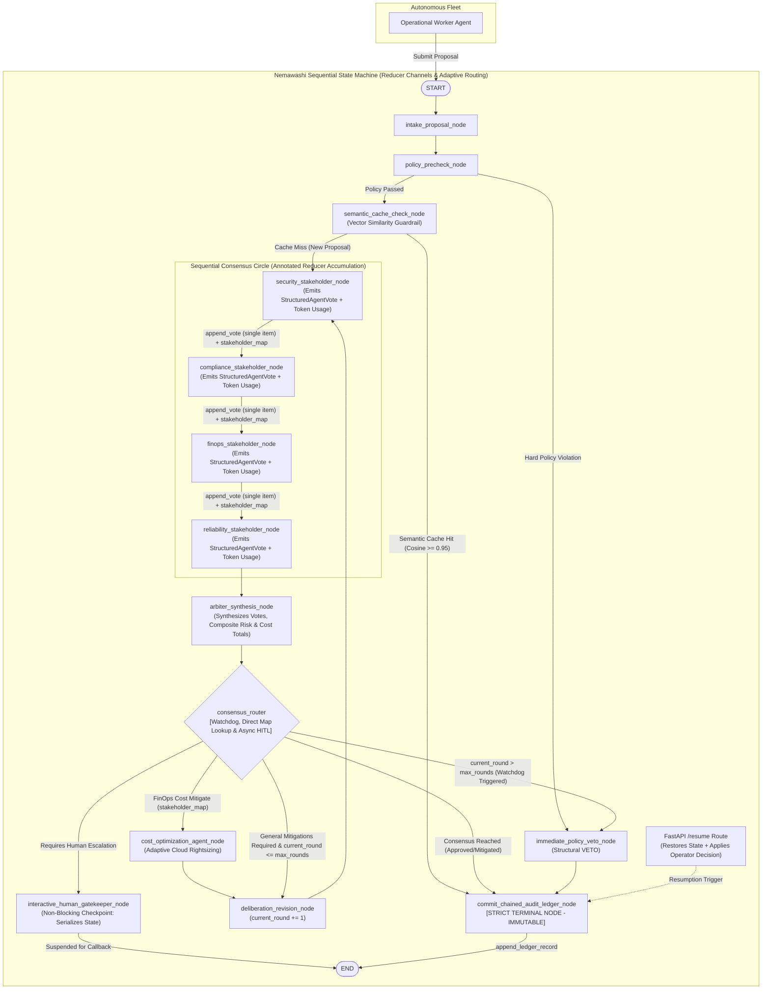

# Implementation Plan: Nemawashi Enterprise Multi-Agent Governance Engine

> **Project Name**: Nemawashi Enterprise Multi-Agent Governance Engine  
> **Workspace Path**: `C:\WWORKING_folder\ProjectFolders\Nemawashi-Governance-Engine`  
> **Runtime**: Python 3.12 (CPython 3.12.15 via `uv`)  
> **Orchestrator**: Isolated LangGraph State Machine (`langgraph`)  
> **LLM Engine**: Gemini API with Native Structured Outputs (`google-genai` / `response_schema`) + Deterministic Offline Mock Fallback  
> **IDE**: Visual Studio Code (Workspace Settings, Debug Launchers, Pytest Integration)  
> **Deliberation Model**: Sequential Nemawashi Consensus (Security → Compliance → FinOps → SRE → Arbiter)  
> **HITL Protocol**: Asynchronous Non-Blocking Checkpoints with Secure FastAPI Gateway (`POST /resume`) + FinOps Dashboard  
> **Audit Integrity**: Cryptographically Chained SHA-256 JSONL Ledger with Immutable Terminal Node Enforcement  
> **State Channel Architecture**: Monomorphic Reducer-Driven `Annotated` State Channels (Zero Consensus Amnesia & Inflation Defense)  
> **Financial Observability**: Real-time Token Accounting & Dynamic Cost Projection per Model Pricing Grid  
> **Latency Optimization**: Pre-Circle Semantic Vector Cache Guardrail Layer (`semantic_cache_check_node`)  
> **Adaptive Resilience**: Dynamic Cost Optimization Agent Re-routing (`cost_optimization_agent_node`)

---

## 1. Executive Summary & Design Decisions (Resolved via /grill-me & Hard Production Fixes)

Through the design review interview, enterprise production risk audits, and FinOps security review, the following core architectural decisions and hard vulnerability mitigations have been locked into the engine specification:

### 1.1 Vulnerability Assessment & Mitigation Matrix

| Vulnerability | Severity | Description | Mitigation Status |
|---|---|---|---|
| **Infinite Mitigation Loop Token Drain** | CRITICAL | Agents can trigger unbounded revision loops when negotiating conflicting constraints, draining LLM token quotas with no circuit breaker. | **MITIGATED**: Watchdog `current_round > max_rounds` hard break enforced in `consensus_router`. |
| **Consensus Amnesia (State Overwrite)** | CRITICAL | Unannotated `TypedDict` collection fields default to overwrite behavior. Downstream node updates erase upstream stakeholder votes. | **MITIGATED**: `votes` and `audit_ledger` channels wrapped in `Annotated` with custom reducers (`append_vote`, `append_ledger_record`). |
| **Reducer Input Polymorphism List Inflation** | HIGH | Baseline reducers accepted collections/lists, allowing compromised nodes to inject multiple votes in one turn, inflating consensus metrics. | **MITIGATED**: `append_vote` strict single-item contract enforced with `TypeError` validation on any collection/list input, plus defensive deep-copying. |
| **Context Dilution & Persona Drift** | HIGH | Free-form conversational exchanges between agents degrade context hygiene, inflate tokens, and cause schema hallucination. | **MITIGATED**: Strict `StructuredAgentVote` Pydantic v2 contract (`extra="forbid"`, `frozen=True`) bound as native `response_schema`. |
| **Audit Trail Mutability** | HIGH | Post-hoc operator modifications or downstream agent mutations can corrupt chronological audit integrity. | **MITIGATED**: `commit_chained_audit_ledger_node` as strict terminal node preceding `END` with SHA-256 hash chaining. |
| **Zero Token/Financial Observability** | CRITICAL | Baseline plan had no mechanism to track cumulative token consumption, completion tokens, or running USD cost across agent turns. | **MITIGATED**: State schema tracks `prompt_tokens`, `completion_tokens`, `total_cost_usd` with pricing grid mapping. |
| **HITL Blocking Loophole & Financial Blindness** | HIGH | Blocking terminal console interactions blocked event loops, stalled distributed containers, and hid deliberation token costs from gatekeepers. | **MITIGATED**: Asynchronous non-blocking checkpoints serialize state to storage, emit webhook alert, and resume via secure FastAPI cryptographic gateway (`POST /resume`) with FinOps metrics. |
| **Duplicate Proposal Token Waste & Latency** | HIGH | Repetitive, identical, or semantically equivalent agent proposals invoke the full multi-agent circle repeatedly, wasting tokens and introducing latency. | **MITIGATED**: Pre-Circle Semantic Cache Guardrail (`semantic_cache_check_node`) queries vector embeddings with 24h TTL and rules-hash hygiene to serve cached verdicts in $<10\text{ms}$. |
| **Stalled Deliberation on Spend Ceilings** | MEDIUM | When FinOps flags a budget breach, proposals enter blind revision cycles without actionable cloud cost re-engineering. | **MITIGATED**: Adaptive Cost Optimization Persona (`cost_optimization_agent_node`) dynamically intercepts cost mitigations and restructures resource payloads. |

---

### 1.2 Deliberation Topology (Sequential Nemawashi)
Stakeholders review in a structured sequence where each stakeholder inspects preceding structured opinions and proposed mitigations:
$$\text{Security Guardian} \longrightarrow \text{Compliance Arbiter} \longrightarrow \text{FinOps Arbiter} \longrightarrow \text{SRE Sentinel} \longrightarrow \text{Consensus Arbiter}$$
This eliminates conflicting mitigations and allows downstream agents (e.g. SRE and FinOps) to factor in upstream security, legal, and regulatory requirements.

### 1.3 State Channel Reducer Enforcement (Zero Consensus Amnesia & Inflation Defense)
The engine strictly binds `votes`, `audit_ledger`, and **atomic token accounting channels** using `typing.Annotated` paired with custom deterministic reducer functions (`append_vote`, `append_ledger_record`, `accumulate_tokens`, `accumulate_costs`). 
- `append_vote` enforces a **monomorphic single-item contract**: only a singular `StructuredAgentVote` is accepted. Any attempt to pass a list or collection throws an immediate `TypeError`, preventing multi-vote injection attacks.
- Incoming state is deep-copied before appending, blocking downstream in-place mutation attempts.

### 1.4 Fix Hole 1: Mitigation Loop Watchdog (`current_round: int = 1`, `max_rounds: int = 3`)
Multi-agent mitigation loops present an operational hazard: agents can trigger infinite revision loops when negotiating conflicting constraints, draining LLM token quotas and stalling mission-critical workloads.
- The LangGraph state contract explicitly tracks `current_round: int = 1` and `max_rounds: int = 3`.
- In the conditional routing function (`consensus_router`), a deterministic guardrail evaluates the round: if `current_round > max_rounds`, the engine **immediately breaks the iteration loop** and routes the proposal straight to a structural `CONSENSUS_VETO` verdict, guaranteeing zero infinite token drain and bounded execution time.
- The watchdog check is the **first condition** evaluated in `consensus_router` before any verdict inspection.

### 1.5 Fix Hole 2: Prevent Context Dilution via Structured Memory (`StructuredAgentVote`)
Loose, arbitrary conversational commentary between agents degrades context window hygiene, induces persona drift, and inflates prompt token consumption.
- The engine strictly prohibits free-form string chatter between agents. All agent interactions exchange an immutable, frozen Pydantic v2 model: `StructuredAgentVote` containing:
  - `stakeholder_id`: `Literal["security", "compliance", "finops", "sre"]`
  - `vote`: `Literal["APPROVE", "REJECT", "MITIGATE"]`
  - `risk_tags`: `list[str]`
  - `mitigation_requirements`: `list[str]`
- Configured with `extra="forbid", frozen=True`. Bound as the native `response_schema` object in all Gemini API calls (`google-genai`).

### 1.6 Fix Hole 3: Immutable Audit Chronology via Terminal Ledger Node (`commit_chained_audit_ledger_node`)
Downstream agent mutations or post-hoc operator modifications must never corrupt the chronological audit trail.
- The `commit_chained_audit_ledger_node` is architected as a strict terminal node in the LangGraph topology, directly preceding `END`. There are no outgoing edges from this node except to `END`.
- Once a state record enters the ledger block, the engine cryptographically seals the record using SHA-256 block-hash chaining (`previous_hash` linking) and freezes the state snapshot. Any subsequent mutation attempts raise an immutable state violation error.

### 1.7 Pre-Circle Semantic Cache Guardrail Layer (`semantic_cache_check_node`)
Autonomous agent swarms frequently generate repetitive operational requests (e.g., periodic cache invalidations, automated daily schema checks, or routine pod scaling). Re-running the entire multi-stakeholder circle for redundant requests wastes API tokens and introduces latency.
- Directly following `policy_precheck_node`, the engine executes `semantic_cache_check_node`.
- It computes a high-density vector embedding of the `AgentProposal.action_description` and compares it against a persistent local semantic vector cache (`src/nemawashi/core/cache.py`).
- If an identical or semantically equivalent proposal ($\text{cosine similarity} \ge 0.95$) was previously deliberated within a versioned execution window, the engine **bypasses the entire multi-agent circle** and pulls the historic consensus resolution directly, routing to the terminal ledger node for verification.
- **Cache Invalidation Hygiene**: The cache checker strictly invalidates entries exceeding a 24-hour TTL or if the cryptographic hash of `enterprise_rules.json` has changed.

### 1.8 Adaptive Cost Optimization Persona (`cost_optimization_agent_node`)
When `finops_stakeholder_node` emits a `MITIGATE` vote due to cost ceilings or expensive instance configurations:
- The `consensus_router` evaluates `stakeholder_map["finops"] == "MITIGATE"` directly and dynamically branches to `cost_optimization_agent_node` (`src/nemawashi/agents/optimizer.py`).
- This specialized persona analyzes the infrastructure proposal, suggests precise cost-reduction adjustments (e.g., re-architecting to spot/preemptible nodes, rightsizing IOPS, applying compute savings reservations), updates the proposal payload parameters, and re-injects the optimized proposal into `deliberation_revision_node` for re-evaluation.

### 1.9 Gemini Native Structured Outputs with Auto Dual-Mode
- When `GEMINI_API_KEY` is present, agents communicate via `google-genai` using native `response_schema` (binding directly to Pydantic models with `temperature=0.1`).
- If `GEMINI_API_KEY` is not detected (offline testing, CI/CD), the engine seamlessly falls back to a deterministic rule-based mock engine that produces 100% schema-compliant `StructuredAgentVote` records validated via `StructuredAgentVote.model_validate()`.
- **Token Accounting**: Both live and offline mock evaluations emit standardized token counts (`prompt_tokens`, `completion_tokens`) derived dynamically from proposal string length for consistent FinOps observability.

### 1.10 Asynchronous Non-Blocking Human-in-the-Loop (HITL) Gateway (`POST /resume`)
When a proposal exceeds policy ceilings (e.g. cost > $500, blast radius > 80, or severe compliance warning):
- The engine serializes the complete graph state to local storage (`storage/suspended_states/{proposal_id}.json`).
- Dispatches an asynchronous mock notification webhook payload containing comprehensive proposal context and FinOps deliberation metrics (`prompt_tokens`, `completion_tokens`, accrued `total_cost_usd`, and `current_round`).
- The execution thread suspends cleanly to `END` without blocking terminal console interactions.
- A secure FastAPI ingress gateway (`POST /resume`) accepts external operator callbacks, applies the signed approval decision and written rationale, and seamlessly triggers graph resumption toward the terminal audit ledger.

---

## 2. System Architecture & LangGraph State Machine



### Deterministic State Graph Edges & Routing Table

| Source Node | Edge Type | Destination / Target | State Channel Action / Reducer | Condition / Evaluation Logic |
|---|---|---|---|---|
| `START` | Direct | `intake_proposal_node` | State init | Ingests initial `AgentProposal` payload |
| `intake_proposal_node` | Direct | `policy_precheck_node` | State update | Evaluates declarative rules (`enterprise_rules.json`) |
| `policy_precheck_node` | Conditional (`policy_routing`) | `immediate_policy_veto_node` | Veto state | `policy_passed == False` (e.g. prohibited destructive commands) |
| `policy_precheck_node` | Conditional (`policy_routing`) | `semantic_cache_check_node` | Cache pre-check | `policy_passed == True` |
| `semantic_cache_check_node` | Conditional (`cache_routing`) | `commit_chained_audit_ledger_node` | Fast-path bypass | `cache_hit == True` (cosine $\ge 0.95$, TTL $\le 24\text{h}$, matching rules hash) |
| `semantic_cache_check_node` | Conditional (`cache_routing`) | `security_stakeholder_node` | Full circle entry | `cache_hit == False` (new proposal) |
| `security_stakeholder_node` | Direct | `compliance_stakeholder_node` | `append_vote`, `stakeholder_map` | Appends single `security` vote + updates `stakeholder_map["security"]` |
| `compliance_stakeholder_node` | Direct | `finops_stakeholder_node` | `append_vote`, `stakeholder_map` | Appends single `compliance` vote + updates `stakeholder_map["compliance"]` |
| `finops_stakeholder_node` | Direct | `reliability_stakeholder_node` | `append_vote`, `stakeholder_map` | Appends single `finops` vote + updates `stakeholder_map["finops"]` |
| `reliability_stakeholder_node` | Direct | `arbiter_synthesis_node` | `append_vote`, `stakeholder_map` | Appends single `sre` vote + updates `stakeholder_map["sre"]` |
| `arbiter_synthesis_node` | Conditional (`consensus_router`) | `immediate_policy_veto_node` | Watchdog veto | `current_round > max_rounds` (Loop Watchdog) OR Arbiter VETO |
| `arbiter_synthesis_node` | Conditional (`consensus_router`) | `cost_optimization_agent_node` | Adaptive re-routing | `stakeholder_map["finops"] == "MITIGATE"` AND `current_round < max_rounds` |
| `arbiter_synthesis_node` | Conditional (`consensus_router`) | `deliberation_revision_node` | Standard revision | `verdict == 'MITIGATE'` (non-cost) AND `current_round < max_rounds` |
| `arbiter_synthesis_node` | Conditional (`consensus_router`) | `interactive_human_gatekeeper_node` | Async checkpoint | `verdict == 'HUMAN_IN_THE_LOOP_ESCALATION'` (serializes state to disk) |
| `arbiter_synthesis_node` | Conditional (`consensus_router`) | `commit_chained_audit_ledger_node` | Resolution state | `verdict in ('UNANIMOUS_CONSENSUS', 'CONDITIONAL_ALIGNMENT')` |
| `cost_optimization_agent_node` | Direct | `deliberation_revision_node` | Payload update | Optimized parameters injected into proposal payload |
| `deliberation_revision_node` | Direct | `security_stakeholder_node` | Round increment | Re-evaluates revised proposal with incremented `current_round` |
| `interactive_human_gatekeeper_node` | Conditional (`hitl_gatekeeper_routing`) | `END` | Non-blocking suspension | `suspended_for_hitl == True` (thread exits cleanly awaiting `/resume`) |
| `interactive_human_gatekeeper_node` | Conditional (`hitl_gatekeeper_routing`) | `commit_chained_audit_ledger_node` | Resumed execution | `human_approved is not None` (operator decision supplied) |
| `immediate_policy_veto_node` | Direct | `commit_chained_audit_ledger_node` | Veto decision | Terminal funnel after structural veto |
| `commit_chained_audit_ledger_node` | Direct (Terminal) | `END` | `append_ledger_record` | Cryptographically seals record; no further execution allowed |

---

## 3. Directory Structure & File Manifest

```
C:\WWORKING_folder\ProjectFolders\Nemawashi-Governance-Engine\
├── .vscode/
│   ├── settings.json                   # Python 3.12 .venv path, pytest configuration, auto-activation
│   ├── launch.json                     # VS Code debug launcher (CLI demo, deliberation scenarios, pytest)
│   └── extensions.json                 # Recommended extensions (Python, Pylance, Ruff)
├── prompts/
│   ├── nemawashi_master_prompt.md     # Master AI governance directive (根回し consensus model)
│   ├── security_stakeholder.md        # Security Guardian agent system prompt
│   ├── compliance_stakeholder.md      # Compliance & Legal Arbiter agent system prompt
│   ├── finops_stakeholder.md          # FinOps & Resource Arbiter agent system prompt
│   ├── sre_stakeholder.md             # SRE & Operational Reliability agent system prompt
│   └── cost_optimizer.md              # Adaptive Cost Optimization agent system prompt
├── src/
│   └── nemawashi/
│       ├── __init__.py                 # Version & package exports
│       ├── main.py                     # FastAPI Ingress Gateway (/resume) & Rich interactive console demo
│       ├── core/
│       │   ├── __init__.py
│       │   ├── models.py               # Pydantic v2 schemas (AgentProposal, StructuredAgentVote, Resolution, Pricing)
│       │   ├── state.py                # LangGraph NemawashiState with single-item append_vote & stakeholder_map
│       │   ├── graph.py                # LangGraph StateGraph with non-blocking HITL checkpointing & terminal ledger
│       │   ├── cache.py                # Local semantic caching engine (Vector embedding similarity with 24h TTL)
│       │   └── engine.py               # High-level orchestrator & client interface (evaluate & resume methods)
│       ├── agents/
│       │   ├── __init__.py
│       │   ├── base.py                 # Gemini native response_schema agent wrapper + offline fallback + token tracking
│       │   ├── security.py             # Security Guardian (zero-trust, privilege, injection defense)
│       │   ├── compliance.py           # Compliance Arbiter (PII, regulatory, auditability)
│       │   ├── finops.py               # FinOps Arbiter (cost ceilings, token rates, quota limits)
│       │   ├── reliability.py          # SRE Sentinel (blast radius, rollback validation, SLOs)
│       │   ├── optimizer.py            # Adaptive Cost Optimization Agent (Dynamic infrastructure rightsizing)
│       │   └── arbiter.py              # Consensus Arbiter (synthesizes votes and FinOps totals into final verdict)
│       ├── policies/
│       │   ├── __init__.py
│       │   ├── policy_engine.py        # Fast deterministic hard-rule pre-checker
│       │   └── enterprise_rules.json   # Declarative rule definitions (hard vetoes, spend caps)
│       └── audit/
│           ├── __init__.py
│           └── ledger.py               # Cryptographic SHA-256 chained audit ledger generator (Terminal node)
├── tests/
│   ├── __init__.py
│   ├── test_models.py                  # Pydantic serialization, schema integrity, and frozen contract tests
│   ├── test_state_reducers.py          # Monomorphic append_vote, inflation rejection, and deep-copy tests
│   ├── test_policy_engine.py           # Deterministic policy validation tests
│   ├── test_cache.py                   # Semantic vector cache cosine similarity and hygiene tests
│   ├── test_agents.py                  # Stakeholder persona mandate and offline fallback tests
│   ├── test_optimizer.py               # Adaptive cost rightsizing tests
│   ├── test_langgraph_routing.py       # LangGraph sequential state machine, watchdog, and non-blocking HITL tests
│   ├── test_audit_chain.py             # Tamper-evidence & SHA-256 hash chaining verification tests
│   ├── test_gemini_schema.py           # Gemini response_schema compatibility tests
│   └── test_e2e_scenarios.py           # End-to-end production scenarios & cryptographic verification
├── .env.example                        # GEMINI_API_KEY and governance configuration template
├── .gitignore                          # Standard Python ignores (.venv, __pycache__, logs, storage)
├── activate.ps1                        # PowerShell one-click virtual environment activator
├── pyproject.toml                      # Standard Python packaging metadata configured for Python 3.12
├── README.md                           # Architecture diagrams, quickstart, and CLI guide
└── requirements.txt                    # Pinned dependencies (langgraph, google-genai, pydantic, fastapi, uvicorn, rich, pytest)
```

---

## 4. Master AI Prompt & Stakeholder Prompts

### `prompts/nemawashi_master_prompt.md`
```markdown
# Nemawashi: Enterprise Multi-Agent Governance Engine (Master Directive)

You are **NEMAWASHI-1**, the Enterprise Multi-Agent Governance Arbiter. Your sole purpose is to enforce rigorous pre-execution alignment, policy compliance, blast radius dampening, and cross-functional consensus across autonomous agent swarms before any production or sensitive action takes place.

### Core Governance Philosophy (根回し - Laying the Groundwork)
Never permit unilateral action execution on high-impact systems. Every agent proposal must undergo asynchronous stakeholder review, risk evaluation, and consensus synthesis.

### The 4 Consensus Verdicts
1. **UNANIMOUS_CONSENSUS (Proceed)**: All stakeholders approve with blast radius <= policy threshold.
2. **CONDITIONAL_ALIGNMENT (Mitigated Proceed)**: Approved subject to automated safety constraints (e.g., dry-run first, rate limit imposed, canary percentage <= 5%).
3. **HUMAN_IN_THE_LOOP_ESCALATION (Gatekeeper Required)**: High financial, legal, or infrastructural impact requires executive human sign-off via asynchronous callback.
4. **CONSENSUS_VETO (Action Blocked)**: Direct violation of zero-trust security policies, hard compliance regulations, or unmitigated catastrophic failure risk.

### Structured Output Enforcement
All decisions and stakeholder votes MUST be returned strictly conforming to the `response_schema` provided (`StructuredAgentVote`). Do not include markdown codeblocks or conversational filler.
```

### `prompts/cost_optimizer.md`
```markdown
# Adaptive Cost Optimization Agent Directive

You are the **Adaptive Cost Optimization Agent** in the Nemawashi Governance Engine.

Your responsibility:
- Analyze infrastructure proposals that have breached FinOps financial ceilings or triggered cost mitigations.
- Formulate concrete, rightsized infrastructure alternatives:
  1. Spot / Preemptible instance allocation for stateless or batch workloads.
  2. Compute Savings Plans or 1-year Reserved Instance coverage.
  3. Dynamic resource scaling down of dev/staging environments outside business hours.
  4. Optimizing storage tiers (e.g. gp2 -> gp3, S3 Standard -> S3 Glacier Instant Retrieval).
- Return an updated `AgentProposal` payload with adjusted `estimated_cost_usd` and mitigation parameters.
```

---

## 5. Sequential Deliberation, Structured Memory & Mitigation Watchdog

### 5.1 Strict Structured Memory Contract (`StructuredAgentVote`)

To eliminate context dilution, persona drift, and token inflation caused by unconstrained conversational exchanges, every stakeholder agent returns and processes an immutable, typed `StructuredAgentVote` model:

```python
from typing import Literal
from pydantic import BaseModel, ConfigDict, Field


class StructuredAgentVote(BaseModel):
    model_config = ConfigDict(extra="forbid", frozen=True)

    stakeholder_id: Literal["security", "compliance", "finops", "sre"] = Field(
        ..., description="Identifier of the reviewing stakeholder persona"
    )
    vote: Literal["APPROVE", "REJECT", "MITIGATE"] = Field(
        ..., description="Explicit binary or conditional vote"
    )
    risk_tags: list[str] = Field(
        default_factory=list,
        description="Categorical tags identifying specific risk vectors",
    )
    mitigation_requirements: list[str] = Field(
        default_factory=list,
        description="Concrete technical constraints or mitigations required",
    )
```

---

### 5.2 State Channel Reducer Enforcement & Atomic Token Accounting

#### The Overwrite Channel & Input Polymorphism Vulnerabilities
In standard LangGraph `TypedDict` implementations, unannotated collection fields default to an **overwrite** channel behavior. When sequential nodes execute, any partial update returning a key replaces the entire existing collection. 
Furthermore, reducers that allow polymorphic inputs (`Union[Item, List[Item]]`) create a **vote inflation vulnerability**, where a compromised node could inject multiple votes during a single turn.

#### Architectural Reducer Solution & Monomorphic Single-Item Contract
To guarantee deterministic accumulation without consensus amnesia or vote inflation, `votes` strictly accepts a singular `StructuredAgentVote` instance. If a list is passed, it explicitly raises a `TypeError` at the boundary:

```python
import copy
from typing import Annotated, Any, Dict, List, Optional, TypedDict
from nemawashi.core.models import AgentProposal, Resolution, StructuredAgentVote


def append_vote(
    existing: Optional[List[StructuredAgentVote]],
    new_vote: StructuredAgentVote,
) -> List[StructuredAgentVote]:
    """Custom channel reducer ensuring single structured votes accumulate without amnesia or inflation.

    Strictly accepts ONLY a singular StructuredAgentVote instance (no Union/List polymorphism).
    Raises TypeError if a list or collection is passed at the boundary.
    Returns a deep-copied list structure to block in-place mutations.
    """
    if isinstance(new_vote, (list, tuple)):
        raise TypeError(
            f"append_vote reducer expects a single StructuredAgentVote instance, got {type(new_vote).__name__}. "
            "Passing lists of votes is strictly forbidden."
        )
    if not isinstance(new_vote, StructuredAgentVote):
        raise TypeError(
            f"append_vote reducer expects a StructuredAgentVote instance, got {type(new_vote).__name__}."
        )

    current: List[StructuredAgentVote] = copy.deepcopy(existing) if existing else []
    current.append(copy.deepcopy(new_vote))
    return current


def append_ledger_record(
    existing: Optional[List[Dict[str, Any]]],
    new_records: Any,
) -> List[Dict[str, Any]]:
    """Custom channel reducer ensuring audit records accumulate immutably."""
    current: List[Dict[str, Any]] = copy.deepcopy(existing) if existing else []
    if isinstance(new_records, list):
        current.extend(copy.deepcopy(new_records))
    else:
        current.append(copy.deepcopy(new_records))
    return current


def accumulate_tokens(existing: Optional[int], new_tokens: Optional[int]) -> int:
    """Atomic reducer accumulating prompt and completion tokens across agent turns."""
    return (existing or 0) + (new_tokens or 0)


def accumulate_costs(existing: Optional[float], new_cost: Optional[float]) -> float:
    """Atomic reducer accumulating running financial costs in USD."""
    return round((existing or 0.0) + (new_cost or 0.0), 6)


class NemawashiState(TypedDict, total=False):
    """LangGraph State Contract with Reducer-Driven Channels.

    The `votes`, `audit_ledger`, and FinOps token channels are wrapped in
    `typing.Annotated` with custom reducers to guarantee cumulative memory
    and eliminate consensus amnesia, router lookup errors, and financial blind spots.
    """

    proposal: AgentProposal
    policy_passed: bool
    policy_violations: List[str]

    # Pre-Circle Semantic Cache State
    cache_hit: bool
    cached_resolution: Optional[Resolution]

    # REDUCER CHANNELS: Guarantee state accumulation without overwrites
    votes: Annotated[List[StructuredAgentVote], append_vote]
    stakeholder_votes: Dict[str, StructuredAgentVote]
    stakeholder_map: Dict[str, str]  # Direct mapping of stakeholder ID to vote verdict
    audit_ledger: Annotated[List[Dict[str, Any]], append_ledger_record]

    # FINOPS TOKEN ACCOUNTING REDUCERS: Real-time cost & token visibility
    prompt_tokens: Annotated[int, accumulate_tokens]
    completion_tokens: Annotated[int, accumulate_tokens]
    total_cost_usd: Annotated[float, accumulate_costs]

    # Adaptive Optimization State
    cost_optimization_applied: bool
    optimized_proposal_parameters: Dict[str, Any]

    # Loop Watchdog State
    current_round: int
    max_rounds: int
    loop_veto_triggered: bool

    # Deliberation & Verdict State
    resolution: Optional[Resolution]
    human_approved: Optional[bool]
    execution_permitted: bool
    human_rationale: str
    audit_committed: bool
    audit_record_hash: Optional[str]

    # Non-Blocking Suspension Flag
    suspended_for_hitl: bool
```

---

### 5.3 Context Passing Across the Consensus Circle

Each node in the sequential consensus circle inspects the proposal along with accumulated prior `StructuredAgentVote` records. Nodes emit a **single structured vote** along with their turn's token consumption and update `stakeholder_map`:

```python
def security_stakeholder_node(state: NemawashiState) -> dict:
    agent = SecurityGuardianAgent()
    vote, tokens = agent.evaluate_with_usage(
        proposal=state["proposal"],
        prior_votes=state.get("stakeholder_votes", {}),
    )
    votes = dict(state.get("stakeholder_votes", {}))
    votes["security"] = vote
    s_map = dict(state.get("stakeholder_map", {}))
    s_map["security"] = vote.vote

    return {
        "votes": vote,  # Emits singular vote to append_vote reducer
        "stakeholder_votes": votes,
        "stakeholder_map": s_map,
        "prompt_tokens": tokens.prompt_tokens,
        "completion_tokens": tokens.completion_tokens,
        "total_cost_usd": tokens.cost_usd,
    }
```

---

### 5.4 Pre-Circle Semantic Cache Guardrail Layer (`src/nemawashi/core/cache.py`)

The `semantic_cache_check_node` intercepts proposals immediately after the deterministic policy pre-check:

```python
def semantic_cache_check_node(state: NemawashiState) -> dict:
    """Calculates vector embedding of proposal and checks local semantic cache.

    If cosine similarity >= 0.95 against a previously committed proposal within the
    24-hour TTL window and matching enterprise rules hash, bypasses the multi-agent circle.
    """
    from nemawashi.core.cache import SemanticProposalCache

    cache = SemanticProposalCache()
    match = cache.lookup(state["proposal"])

    if match and match.similarity >= 0.95:
        return {
            "cache_hit": True,
            "cached_resolution": match.resolution,
            "resolution": match.resolution,
            "execution_permitted": match.resolution.verdict
            in ("UNANIMOUS_CONSENSUS", "CONDITIONAL_ALIGNMENT"),
        }

    return {"cache_hit": False}
```

---

### 5.5 Adaptive Cost Optimization Persona (`src/nemawashi/agents/optimizer.py`)

When FinOps triggers a cost ceiling mitigation, the dynamic branching edge routes to `cost_optimization_agent_node`:

```python
def cost_optimization_agent_node(state: NemawashiState) -> dict:
    """Specialized FinOps optimizer that restructures the proposal for cost efficiency."""
    from nemawashi.agents.optimizer import CostOptimizationAgent

    optimizer = CostOptimizationAgent()
    optimized_proposal = optimizer.optimize(
        proposal=state["proposal"],
        finops_vote=state.get("stakeholder_votes", {}).get("finops"),
    )

    return {
        "proposal": optimized_proposal,
        "cost_optimization_applied": True,
        "optimized_proposal_parameters": optimized_proposal.parameters,
    }
```

---

### 5.6 Mitigation Loop Watchdog & Dynamic Routing Implementation

```python
def consensus_router(state: NemawashiState) -> str:
    current_round = state.get("current_round", 1)
    max_rounds = state.get("max_rounds", 3)
    
    # 1. Watchdog: Hard break on loop exhaustion
    if current_round > max_rounds:
        return "immediate_policy_veto_node"
        
    resolution = state.get("resolution")
    if not resolution:
        return "immediate_policy_veto_node"
        
    if resolution.verdict == "CONSENSUS_VETO":
        return "immediate_policy_veto_node"
        
    # 2. Adaptive Cost Optimization Branching via stakeholder_map
    finops_decision = state.get("stakeholder_map", {}).get("finops")
    finops_vote = state.get("stakeholder_votes", {}).get("finops")
    if (
        finops_decision == "MITIGATE"
        and finops_vote
        and any("budget" in tag or "cost" in tag for tag in finops_vote.risk_tags)
        and not state.get("cost_optimization_applied", False)
        and current_round < max_rounds
    ):
        return "cost_optimization_agent_node"
        
    # 3. Standard Revision Loop
    if resolution.verdict == "CONDITIONAL_ALIGNMENT" and resolution.requires_revision:
        if current_round >= max_rounds:
            return "immediate_policy_veto_node"
        return "deliberation_revision_node"
        
    # 4. Asynchronous HITL Checkpoint (Non-blocking serialization)
    if resolution.verdict == "HUMAN_IN_THE_LOOP_ESCALATION":
        if state.get("human_approved") is None:
            save_suspended_state(state)
            emit_mock_notification_webhook(state)
        return "interactive_human_gatekeeper_node"
        
    return "commit_chained_audit_ledger_node"
```

---

## 6. Cryptographically Chained Ledger Specification (`src/nemawashi/audit/ledger.py`)

Each audit record calculates:
$$\text{record\_hash} = \text{SHA256}(\text{index} + \text{previous\_hash} + \text{timestamp} + \text{proposal\_id} + \text{verdict} + \text{execution\_permitted} + \text{composite\_risk} + \text{votes} + \text{mitigations} + \text{human\_approval} + \text{round})$$

### Strict Terminal Node Enforcement
`commit_chained_audit_ledger_node` is the single terminal node in the LangGraph topology directly preceding `END`:
```python
# Graph topology configuration
builder.add_edge("commit_chained_audit_ledger_node", END)
```
Once entered, the ledger node:
1. Validates that the state has not already been sealed (`audit_committed == False`).
2. Calculates the deterministic SHA-256 hash chaining to the previous ledger entry, including final token totals and accrued USD cost.
3. Atomically appends the record to `audit_logs/nemawashi_ledger.jsonl`.
4. Updates the semantic vector cache with the committed resolution if not already cached.
5. Appends the sealed audit block to the `audit_ledger` channel via `append_ledger_record`.
6. Returns an immutable state dictionary with `audit_committed = True` and `audit_record_hash = record_hash`.

---

## 7. Asynchronous Non-Blocking Human-in-the-Loop (HITL) Gateway & Checkpoint

To eliminate blocking execution loops and prevent distributed container timeouts, blocking terminal console interactions have been completely removed. The HITL gatekeeper operates via an **Asynchronous Non-Blocking Checkpoint mechanism** paired with a secure FastAPI callback gateway route:

```python
# 1. Non-Blocking Checkpoint Node (src/nemawashi/core/graph.py)
def interactive_human_gatekeeper_node(state: NemawashiState) -> dict:
    """Non-blocking human gatekeeper checkpoint.

    If operator decision is pending (human_approved is None), flags the thread
    as suspended and exits cleanly to END without blocking the event loop.
    When operator decision arrives via the FastAPI gateway (/resume), applies
    the decision and routes toward the terminal audit ledger node.
    """
    if state.get("human_approved") is None:
        return {
            "suspended_for_hitl": True,
            "execution_permitted": False,
        }

    approved = bool(state.get("human_approved"))
    return {
        "human_approved": approved,
        "execution_permitted": approved,
        "human_rationale": state.get(
            "human_rationale", "Operator decision supplied via gateway callback"
        ),
        "suspended_for_hitl": False,
    }


# 2. FastAPI Ingress Resumption Gateway (src/nemawashi/main.py)
from fastapi import FastAPI, HTTPException, status
from pydantic import BaseModel, Field

app = FastAPI(
    title="Nemawashi Multi-Agent Governance Engine Gateway",
    description="Non-blocking ingress gateway for asynchronous human-in-the-loop deliberation callbacks.",
    version="1.1.0",
)


class ResumeProposalRequest(BaseModel):
    proposal_id: str = Field(
        ..., min_length=1, description="Proposal identifier matching suspended state"
    )
    approved: bool = Field(
        ..., description="Operator decision: True to authorize, False to veto"
    )
    rationale: str = Field(
        default="Operator decision supplied via FastAPI gateway callback"
    )
    auth_token: Optional[str] = Field(
        default=None, description="Cryptographic callback authorization token"
    )


@app.post("/resume", status_code=status.HTTP_200_OK)
def resume_deliberation(request: ResumeProposalRequest):
    """External callback endpoint for resuming suspended HITL deliberations."""
    engine = NemawashiEngine()
    final_state = engine.resume_proposal(
        proposal_id=request.proposal_id,
        approved=request.approved,
        rationale=request.rationale,
    )
    return {
        "status": "RESUMED",
        "proposal_id": request.proposal_id,
        "execution_permitted": final_state.get("execution_permitted", False),
        "human_approved": final_state.get("human_approved"),
        "verdict": final_state.get("resolution").verdict
        if final_state.get("resolution")
        else "UNKNOWN",
        "audit_record_hash": final_state.get("audit_record_hash"),
        "audit_committed": final_state.get("audit_committed", False),
        "total_cost_usd": final_state.get("total_cost_usd", 0.0),
    }
```

---

## 8. Verification & Execution Steps

1. **Virtual Environment Provisioning**:
   ```powershell
   uv venv --python 3.12 C:\WWORKING_folder\ProjectFolders\Nemawashi-Governance-Engine\.venv
   ```
2. **Install Core Dependencies**:
   ```powershell
   uv pip install -r C:\WWORKING_folder\ProjectFolders\Nemawashi-Governance-Engine\requirements.txt
   ```
3. **Execute Automated Pytest Suite**:
   ```powershell
   & "C:\WWORKING_folder\ProjectFolders\Nemawashi-Governance-Engine\.venv\Scripts\python.exe" -m pytest "C:\WWORKING_folder\ProjectFolders\Nemawashi-Governance-Engine\tests" -v
   ```
4. **Run Live Interactive CLI Scenarios**:
   ```powershell
   & "C:\WWORKING_folder\ProjectFolders\Nemawashi-Governance-Engine\.venv\Scripts\python.exe" -m nemawashi.main
   ```
5. **Start FastAPI Ingress Gateway**:
   ```powershell
   & "C:\WWORKING_folder\ProjectFolders\Nemawashi-Governance-Engine\.venv\Scripts\python.exe" -m nemawashi.main --serve
   ```
