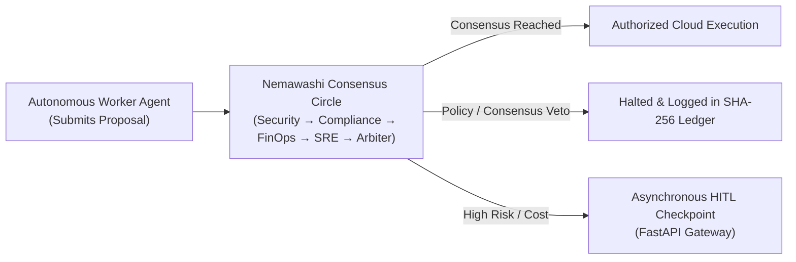
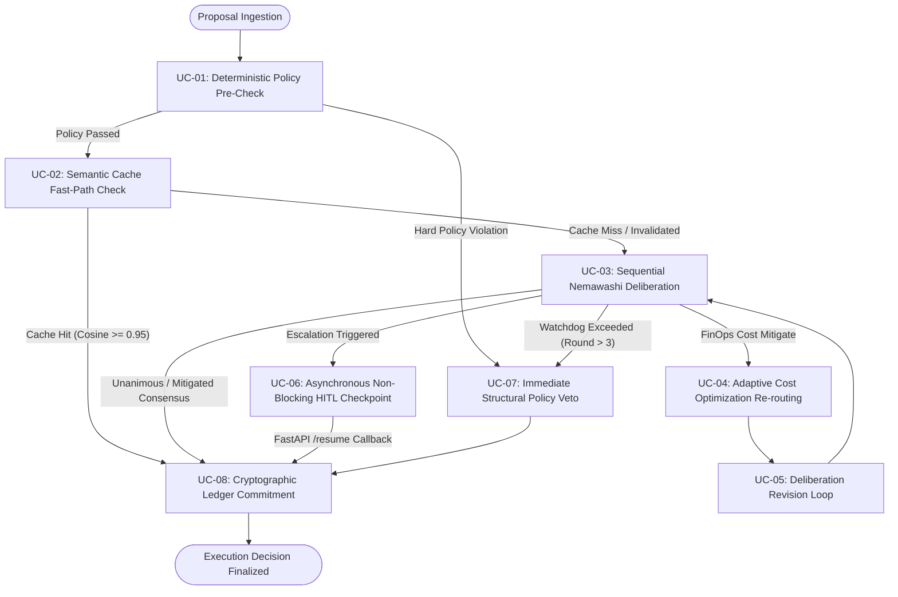
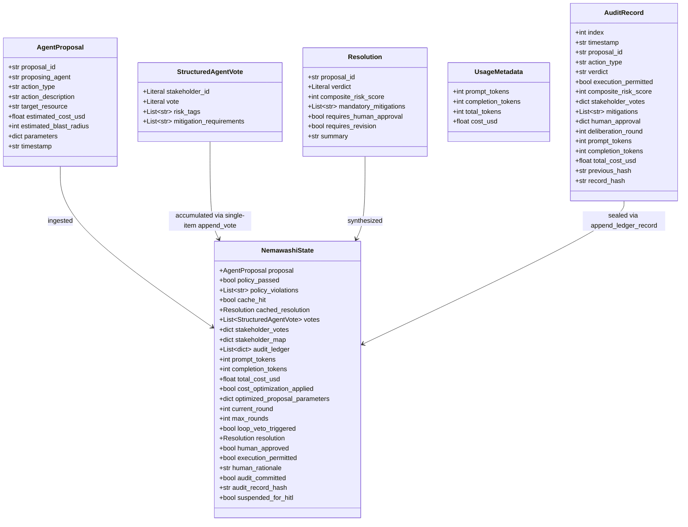

# User Requirements Document (URD)
## Nemawashi Enterprise Multi-Agent Governance Engine

> **Document Identifier**: NMW-URD-2026-V1  
> **Target System**: Nemawashi Enterprise Multi-Agent Governance Engine  
> **Workspace Path**: `C:\WWORKING_folder\ProjectFolders\Nemawashi-Governance-Engine\`  
> **Document Version**: 1.2.0 (High-Availability & Non-Blocking Security Hardened)  
> **Classification**: Enterprise Restricted / Engineering Architecture Specification  
> **Author**: Lead AI Platform Engineer & Principal AI Systems Architect  
> **Target Runtime**: Python 3.12 (CPython 3.12.15 via `uv`)  
> **State Machine Orchestrator**: LangGraph StateGraph with `Annotated` Reducer Channels  
> **Model Provider**: Gemini API (`google-genai` / native `response_schema`) + Deterministic Offline Mock Fallback  

---

## 1. Executive Summary & System Philosophy

### 1.1 Purpose
The purpose of this User Requirements Document (URD) is to establish the formal functional, operational, financial, and compliance requirements for the **Nemawashi Enterprise Multi-Agent Governance Engine**. This system acts as an autonomous pre-execution safety gatekeeper, preventing rogue, uncoordinated, non-compliant, or cost-prohibitive actions by autonomous agent fleets before sensitive infrastructure mutations occur.

### 1.2 Core Philosophy: Nemawashi (根回し)
In enterprise Japanese organizational management, *Nemawashi* (根回し) refers to the practice of laying groundwork, building informal alignment, and gathering cross-functional consensus prior to presenting a formal proposal or executing a high-stakes initiative.

In modern multi-agent systems, agents frequently operate in siloed autonomy:
- A developer agent might scale an expensive GPU cluster without FinOps oversight.
- An infrastructure bot might open port `0.0.0.0/0` to fix connectivity, creating an ingress security breach.
- A database maintenance bot might execute a table drop without SRE rollback verification or compliance data retention checks.

The Nemawashi Governance Engine translates this cultural philosophy into an autonomous LangGraph state machine: **no sensitive action executes unilaterally**. Every proposal must pass through a sequential consensus circle of specialized stakeholder personas (Security, Compliance, FinOps, SRE), each reviewing accumulated opinions, proposing concrete mitigations, and achieving cryptographic consensus.

---

## 2. Stakeholder Personas & Actor Profiles

| Persona ID | Stakeholder Persona | Organizational Mandate | Primary Concerns |
|---|---|---|---|
| **PER-01** | **Platform Operator / Executive Gatekeeper** | Platform Engineering Lead / VP of Infrastructure | Final sign-off on escalated high-cost, high-blast-radius, or high-compliance operations via callback. |
| **PER-02** | **Autonomous Worker Agent** | Operational Agent Swarms (DevOps, Data, AI Workers) | Programmatic submission of `AgentProposal` payloads requesting execution authorization. |
| **PER-03** | **Security Guardian** | Office of the CISO & Zero-Trust Engineering | Zero-trust enforcement, IAM least privilege, prompt injection defense, ingress lockdown, secret management. |
| **PER-04** | **Compliance & Legal Arbiter** | Corporate Governance, Legal, and Risk Management | Regulatory compliance (GDPR Art 30, HIPAA PHI, SOC 2 Type II, PCI-DSS), auditability, data residency. |
| **PER-05** | **FinOps Arbiter** | Cloud Financial Management & Token Accounting | Cost ceilings, resource rightsizing, token consumption budgets, unit economics, quota exhaustion. |
| **PER-06** | **SRE Sentinel** | Site Reliability & Production Resilience | Blast radius containment, SLO preservation, automated rollback validation, canary stages, health probes. |
| **PER-07** | **Consensus Arbiter** | AI Governance Core Engine | Synthesis of cross-functional votes, composite risk scoring, mitigation deduplication, verdict arbitration. |
| **PER-08** | **Adaptive Cost Optimizer** | Cloud Infrastructure Rightsizing Specialist | Dynamic re-engineering of resource proposals flagged for budget mitigations (spot/preemptible conversions). |
| **PER-09** | **Internal / External Auditor** | Independent Audit & Regulatory Verification | Cryptographic verification of the SHA-256 chained audit ledger, non-repudiation of past verdicts. |

### 2.1 RACI Matrix

| Governance Stage | Worker Agent | Security Guardian | Compliance Arbiter | FinOps Arbiter | SRE Sentinel | Consensus Arbiter | Human Gatekeeper | Cost Optimizer |
|---|---|---|---|---|---|---|---|---|
| **Proposal Submission** | **R** | I | I | I | I | A | I | I |
| **Policy Pre-Check** | I | C | C | C | C | **A** | I | I |
| **Semantic Cache Check** | I | I | I | I | I | **A** | I | I |
| **Security Review** | I | **R** | I | I | I | A | I | I |
| **Compliance Review** | I | C | **R** | I | I | A | I | I |
| **FinOps Review** | I | I | C | **R** | I | A | I | I |
| **SRE Review** | I | C | C | C | **R** | A | I | I |
| **Cost Optimization** | I | I | I | C | I | A | I | **R** |
| **Verdict Synthesis** | I | C | C | C | C | **R/A** | I | I |
| **Async HITL Checkpoint** | I | I | I | I | I | C | **R/A** | I |
| **Ledger Commitment** | I | I | I | I | I | **A** | I | I |

*Legend: R = Responsible, A = Accountable, C = Consulted, I = Informed*

---

## 3. Operational Use Cases

### UC-01: Deterministic Policy Pre-Check
- **Primary Actor**: Consensus Engine
- **Preconditions**: Worker Agent submits valid `AgentProposal`.
- **Trigger**: New proposal enters `policy_precheck_node`.
- **Main Flow**:
  1. Engine loads declarative rules from `enterprise_rules.json`.
  2. Evaluates action against blacklisted operations (e.g., `drop_production_database`).
  3. Evaluates target against protected resource substrings (e.g., `prod-primary-db`).
  4. Evaluates estimated cost against platform ceiling ($5,000.00 USD).
  5. If violations exist, sets `policy_passed = False` and routes to `immediate_policy_veto_node`.
  6. If compliant, sets `policy_passed = True` and proceeds to Semantic Cache Check.

### UC-02: Fast-Path Execution via Semantic Cache Hit
- **Primary Actor**: Consensus Engine / Worker Agent
- **Preconditions**: Proposal passed policy pre-check.
- **Trigger**: `semantic_cache_check_node` calculates vector embedding of `action_description`.
- **Main Flow**:
  1. Engine verifies strict cache hygiene: The semantic cache checker MUST invalidate hits if the target entry exceeds a 24-hour Time-To-Live (TTL) window OR if the cryptographic hash of `enterprise_rules.json` has changed since the cache index was compiled, ensuring stale policy bypasses are impossible.
  2. Engine queries local persistent vector index in `cache/semantic_cache.json`.
  3. Computes cosine similarity between query embedding and cached proposal vectors.
  4. If similarity $\ge 0.95$ and cache hygiene validation passes:
     - Retrieves historic consensus resolution.
     - Emits `cache_hit = True`.
     - Bypasses the 4-agent deliberation circle entirely.
     - Routes directly to terminal ledger node with zero API token spend and $<5\text{ms}$ latency.
  5. If similarity $< 0.95$ or cache hit is invalidated, proceeds to Security Guardian.

### UC-03: Sequential Multi-Agent Deliberation (Nemawashi Circle)
- **Primary Actors**: Security Guardian, Compliance Arbiter, FinOps Arbiter, SRE Sentinel, Consensus Arbiter
- **Preconditions**: Cache miss on compliant proposal.
- **Main Flow**:
  1. **Security Guardian**: Evaluates zero-trust, privilege boundaries, and injection defense. Emits typed `StructuredAgentVote` (`APPROVE`, `REJECT`, or `MITIGATE`) and token usage. Populates `stakeholder_map["security"]`.
  2. **Compliance Arbiter**: Inspects proposal + Security vote. Evaluates GDPR, HIPAA, SOC 2, and audit logging. Emits `StructuredAgentVote` and token usage. Populates `stakeholder_map["compliance"]`.
  3. **FinOps Arbiter**: Inspects proposal + Security + Compliance votes. Evaluates cloud spend, quota boundaries, and token unit economics. Emits `StructuredAgentVote` and token usage. Populates `stakeholder_map["finops"]`.
  4. **SRE Sentinel**: Inspects proposal + all preceding votes. Evaluates blast radius, SLOs, rollback plans, and canaries. Emits `StructuredAgentVote` and token usage. Populates `stakeholder_map["sre"]`.
  5. **Consensus Arbiter**: Aggregates all votes, deduplicates mitigations, calculates normalized composite risk score (0-100), and synthesizes final `Resolution`.

### UC-04: Adaptive Cost Optimization Re-routing
- **Primary Actors**: FinOps Arbiter, Cost Optimization Agent, Consensus Router
- **Preconditions**: `finops_stakeholder_node` votes `MITIGATE` due to cost ceiling breach, and `current_round < max_rounds`.
- **Main Flow**:
  1. `consensus_router` intercepts FinOps cost mitigation trigger via direct lookup on `stakeholder_map["finops"]`.
  2. Branches to `cost_optimization_agent_node`.
  3. Cost Optimizer analyzes infrastructure parameters (instance types, storage tiers, utilization schedules).
  4. Restructures proposal: converts on-demand instances to spot/preemptible instances, enables 1-year compute savings plans, or rightsizes disk tiers.
  5. Updates `AgentProposal.estimated_cost_usd` and payload parameters.
  6. Re-injects optimized proposal into `deliberation_revision_node` for re-evaluation in Round 2.

### UC-05: Mitigation Loop Watchdog & Circuit Breaking
- **Primary Actor**: Consensus Router
- **Preconditions**: Proposal requires revisions or iterative mitigation negotiation.
- **Main Flow**:
  1. Engine checks `current_round` against `max_rounds` (default: 3).
  2. If `current_round > max_rounds` or if boundary revision would exceed ceiling:
     - Breaks the iteration loop immediately.
     - Sets `loop_veto_triggered = True`.
     - Issues a structural `CONSENSUS_VETO`.
     - Prevents infinite loop execution and token budget drain.
     - Routes straight to terminal ledger node.

### UC-06: Asynchronous Non-Blocking Human-in-the-Loop (HITL) Checkpoint & Gateway Resumption
- **Primary Actor**: Platform Operator / Executive Gatekeeper, FastAPI Ingress Gateway
- **Preconditions**: Proposal has estimated cost $\ge \$500.00$, blast radius $\ge 80/100$, composite risk $\ge 75/100$, or touches sensitive compliance domains (e.g. HIPAA/PCI).
- **Main Flow**:
  1. When escalation criteria are triggered, the engine enters `interactive_human_gatekeeper_node`. Synchronous interactive console prompts and blocking terminal console interactions are strictly eliminated.
  2. The Human-in-the-Loop node operates via an Asynchronous Non-Blocking Checkpoint mechanism that serializes state to persistent storage (`storage/suspended_states/{proposal_id}.json`), dispatches an asynchronous webhook alert payload, and suspends execution cleanly.
  3. The dispatched asynchronous webhook payload contains complete proposal context and FinOps deliberation metrics (including live token counts `prompt_tokens`, `completion_tokens`, accrued `total_cost_usd`, and deliberation round index).
  4. Human gatekeeper receives the alert out-of-band and submits a signed cryptographic approval/rejection callback.
  5. The engine resumes execution via a secure FastAPI cryptographic callback gateway route (`POST /resume`), which validates the cryptographic token, deserializes the checkpointed graph state, applies `human_approved` and `human_rationale`, and triggers seamless graph resumption toward the terminal audit ledger node.

### UC-07: Immediate Structural Policy Veto
- **Primary Actor**: Consensus Engine
- **Preconditions**: Proposal violated hard policy pre-check or triggered watchdog loop veto.
- **Main Flow**:
  1. Engine sets `execution_permitted = False` and `verdict = "CONSENSUS_VETO"`.
  2. Records specific policy violation messages into `policy_violations`.
  3. Bypasses human gatekeeper and agent deliberation.
  4. Routes immediately to terminal ledger node for permanent immutable recording.

### UC-08: Cryptographically Chained Ledger Commitment & Verification
- **Primary Actors**: Consensus Engine, Internal/External Auditor
- **Preconditions**: Any deliberation reaches a terminal state.
- **Main Flow**:
  1. `commit_chained_audit_ledger_node` asserts state is uncommitted (`audit_committed == False`).
  2. Retrieves `previous_hash` from the latest record in `audit_logs/nemawashi_ledger.jsonl` (or genesis hash `0` × 64).
  3. Computes deterministic SHA-256 block hash across index, timestamp, proposal ID, verdict, structured votes, mitigations, human sign-off, token metrics, and round number.
  4. Atomically appends `AuditRecord` JSON line to ledger.
  5. Seals state with `audit_committed = True` and transitions directly to LangGraph `END`.
  6. Auditor executes `verify_ledger_chain()` to mathematically verify unbroken hash chaining across all blocks.

---

## 4. Comprehensive Functional Requirements (FR)

### FR-01: Proposal Intake & Validation
- **FR-01.1**: The system MUST accept proposal inputs conforming to the `AgentProposal` schema.
- **FR-01.2**: The system MUST validate that `proposal_id` is a non-empty string and generate an ISO 8601 UTC timestamp if omitted.
- **FR-01.3**: The system MUST reject proposals with negative `estimated_cost_usd` or `estimated_blast_radius` outside $[0, 100]$.
- **FR-01.4**: The system MUST initialize a pristine `NemawashiState` instance with `current_round = 1`, `max_rounds = 3`, and empty reducer channels.

### FR-02: Deterministic Enterprise Policy Engine
- **FR-02.1**: The engine MUST evaluate proposals against declarative rules defined in `enterprise_rules.json` prior to any LLM invocation.
- **FR-02.2**: The engine MUST immediately veto any proposal matching blacklisted action types (e.g., `drop_production_database`, `delete_root_iam_credentials`).
- **FR-02.3**: The engine MUST immediately veto any proposal containing protected resource substrings (e.g., `prod-primary-db`, `root-kms-key`).
- **FR-02.4**: The engine MUST immediately veto any proposal with `estimated_cost_usd` exceeding the absolute platform ceiling ($\$5,000.00$ USD).
- **FR-02.5**: The policy engine MUST flag proposals requiring HITL escalation if cost $\ge \$500.00$, blast radius $\ge 80$, or target is listed in `sensitive_resources`.

### FR-03: Pre-Circle Semantic Cache Guardrail Layer & Hygiene
- **FR-03.1**: The system MUST compute a deterministic normalized vector embedding of `action_type`, `target_resource`, and `action_description`.
- **FR-03.2**: The system MUST query `cache/semantic_cache.json` for previously committed proposals matching the query with cosine similarity $\ge 0.95$.
- **FR-03.3**: Strict Cache Invalidation Hygiene: The semantic cache checker MUST invalidate hits if the target entry exceeds a 24-hour Time-To-Live (TTL) window OR if the cryptographic hash of `enterprise_rules.json` has changed since the cache index was compiled, ensuring stale policy bypasses are impossible.
- **FR-03.4**: Upon valid cache hit, the system MUST bypass all stakeholder agent nodes and route directly to the terminal ledger node.
- **FR-03.5**: Upon cache miss or cache invalidation, the system MUST proceed to the first sequential stakeholder node (`security_stakeholder_node`).
- **FR-03.6**: The terminal ledger node MUST automatically index newly committed resolutions into the semantic cache alongside compilation timestamp and active ruleset hash.

### FR-04: Sequential Deliberation Circle
- **FR-04.1**: The system MUST execute stakeholder reviews in strict sequential order:
  $$\text{Security Guardian} \longrightarrow \text{Compliance Arbiter} \longrightarrow \text{FinOps Arbiter} \longrightarrow \text{SRE Sentinel} \longrightarrow \text{Consensus Arbiter}$$
- **FR-04.2**: Each stakeholder node MUST have full visibility into the proposal and all prior structured votes emitted in the current round.
- **FR-04.3**: No stakeholder node shall execute concurrently with another stakeholder in a manner that bypasses sequential visibility.

### FR-05: Strict Structured Memory Contracts (`StructuredAgentVote`)
- **FR-05.1**: All stakeholder agents MUST return structured outputs conforming to `StructuredAgentVote`.
- **FR-05.2**: The schema MUST enforce `extra="forbid"` and `frozen=True` to strictly prohibit free-form conversational chatter, arbitrary keys, or post-instantiation mutations.
- **FR-05.3**: The schema MUST constrain `stakeholder_id` to `Literal["security", "compliance", "finops", "sre"]`.
- **FR-05.4**: The schema MUST constrain `vote` to `Literal["APPROVE", "REJECT", "MITIGATE"]`.
- **FR-05.5**: When live Gemini API credentials are present, the agent MUST bind `StructuredAgentVote` as the native `response_schema` in `google-genai`.

### FR-06: State Channel Reducers & Inflation Prevention (Zero Consensus Amnesia)
- **FR-06.1**: The LangGraph state contract MUST wrap the `votes` channel with `typing.Annotated[List[StructuredAgentVote], append_vote]`.
- **FR-06.2**: Rejection of List Polymorphism: The `append_vote` reducer MUST accept ONLY a singular `StructuredAgentVote` instance. The reducer strictly rejects list polymorphism and throws a `TypeError` if a collection or list is passed to the boundary, preventing vote inflation vectors.
- **FR-06.3**: Defensive Deep-Copy: The `append_vote` reducer MUST return a deep-copied list structure to block downstream in-place mutation attacks.
- **FR-06.4**: Each stakeholder node MUST emit `{"votes": vote}` (a single `StructuredAgentVote` instance) and update `stakeholder_map[stakeholder_id] = vote.vote`.
- **FR-06.5**: The LangGraph state contract MUST wrap the `audit_ledger` channel with `typing.Annotated[List[Dict[str, Any]], append_ledger_record]`.

### FR-07: Atomic FinOps Token & Cost Accounting
- **FR-07.1**: The state contract MUST track `prompt_tokens`, `completion_tokens`, and `total_cost_usd` wrapped in `typing.Annotated` with atomic reducers `accumulate_tokens` and `accumulate_costs`.
- **FR-07.2**: Both live Gemini and offline mock agents MUST capture and emit `UsageMetadata` containing input tokens, output tokens, and calculated USD cost.
- **FR-07.3**: The system MUST calculate costs dynamically using `MODEL_PRICING_GRID` configured per model tier (e.g. Gemini 2.5 Flash input $\$0.075 / 1\text{M}$, output $\$0.30 / 1\text{M}$).
- **FR-07.4**: Reducers MUST prevent race conditions or partial updates during parallel transitions.

### FR-08: Mitigation Loop Watchdog & Circuit Breaking
- **FR-08.1**: The state contract MUST track `current_round: int` (default 1) and `max_rounds: int` (default 3).
- **FR-08.2**: The conditional routing function (`consensus_router`) MUST evaluate `current_round > max_rounds` as its **first priority check**.
- **FR-08.3**: If the watchdog triggers, the router MUST immediately transition to `immediate_policy_veto_node`, set `loop_veto_triggered = True`, and issue a structural `CONSENSUS_VETO`.
- **FR-08.4**: In `deliberation_revision_node`, the engine MUST increment `current_round` by exactly 1.

### FR-09: Adaptive Cost Optimization Persona & Dynamic Re-routing
- **FR-09.1**: When `finops_stakeholder_node` votes `MITIGATE` due to cost/budget risks, `consensus_router` MUST dynamically route to `cost_optimization_agent_node` using `stakeholder_map["finops"]`.
- **FR-09.2**: The `CostOptimizationAgent` MUST restructure proposal parameters to apply spot instances, compute savings plans, or off-peak shutdown rules.
- **FR-09.3**: The optimizer MUST recalculate `estimated_cost_usd` to reflect rightsized savings (typically 30%–55% reduction).
- **FR-09.4**: The optimizer MUST record `cost_optimization_applied = True` and pass the revised proposal into `deliberation_revision_node` for re-evaluation.

### FR-10: Asynchronous Non-Blocking Human Gatekeeper Checkpoint & FinOps Dashboard
- **FR-10.1**: When `verdict == "HUMAN_IN_THE_LOOP_ESCALATION"`, the engine MUST route to `interactive_human_gatekeeper_node`.
- **FR-10.2**: Asynchronous Non-Blocking Checkpoint: The HITL node MUST operate via an Asynchronous Non-Blocking Checkpoint mechanism that serializes the complete graph state to persistent local storage (`storage/suspended_states/{proposal_id}.json`), fires an asynchronous webhook alert payload, and suspends thread execution cleanly.
- **FR-10.3**: Elimination of Synchronous Console Prompts: All references to synchronous interactive console prompts or blocking terminal console interactions are strictly forbidden in the governance engine topology.
- **FR-10.4**: The escalation webhook payload MUST expose comprehensive deliberation context: proposal ID, action description, estimated cost, blast radius, composite risk score, and required mitigations.
- **FR-10.5**: The escalation notification MUST display live FinOps metrics: `prompt_tokens`, `completion_tokens`, accrued `total_cost_usd`, and `current_round`.
- **FR-10.6**: Secure FastAPI Callback Gateway: The engine MUST remain suspended until execution is resumed via a secure FastAPI cryptographic callback gateway route (`POST /resume`), which verifies callback authenticity, deserializes the state, applies operator decision (`[A]pprove / [R]eject`) and mandatory justification string (`human_rationale`), and commits the final record to the terminal ledger.
- **FR-10.7**: The node MUST support automated test override via pre-populated `state["human_approved"]` to enable headless CI/CD execution and unit testing.

### FR-11: Cryptographically Chained SHA-256 Terminal Ledger
- **FR-11.1**: `commit_chained_audit_ledger_node` MUST be registered as the strict terminal node in the LangGraph topology, directly preceding `END`.
- **FR-11.2**: No outgoing edge shall exist from `commit_chained_audit_ledger_node` other than to `END`.
- **FR-11.3**: The node MUST assert that `state["audit_committed"] == False` and raise `RuntimeError` if an already-sealed state is re-submitted.
- **FR-11.4**: Each ledger block MUST calculate:
  $$\text{record\_hash} = \text{SHA256}(\text{index} + \text{previous\_hash} + \text{timestamp} + \text{proposal\_id} + \text{verdict} + \text{execution\_permitted} + \text{composite\_risk} + \text{votes} + \text{mitigations} + \text{human\_approval} + \text{round})$$
- **FR-11.5**: Block 0 MUST chain to genesis hash `"0" * 64`.
- **FR-11.6**: The engine MUST provide `verify_ledger_chain()` to mathematically audit the entire JSONL file and detect any byte-level tampering.

### FR-12: Dual-Mode Execution Engine
- **FR-12.1**: When `GEMINI_API_KEY` is detected, agents MUST call Gemini API (`gemini-2.5-flash`) with structured outputs.
- **FR-12.2**: When `GEMINI_API_KEY` is absent or unreachable, agents MUST seamlessly fall back to deterministic rule-based evaluation.
- **FR-12.3**: Both live Gemini API and offline mock evaluations MUST pass candidate vote data payloads directly through `StructuredAgentVote.model_validate()` before state injection.
- **FR-12.4**: The offline mock engine MUST calculate synthetic token counts derived from the length of the proposal string so pricing grids function identically across dev and production.

---

## 5. Non-Functional Requirements (NFR)

### NFR-01: Performance & Latency Budgets
- **NFR-01.1 (Cache Latency)**: Semantic cache lookup and verdict retrieval MUST complete in $< 10\text{ms}$ on standard hardware.
- **NFR-01.2 (Policy Pre-check Latency)**: Deterministic policy evaluation MUST complete in $< 5\text{ms}$.
- **NFR-01.3 (Offline Deliberation)**: A complete 4-stakeholder offline mock deliberation cycle MUST complete in $< 1.5\text{s}$.
- **NFR-01.4 (Online Deliberation)**: Under live Gemini API execution, each agent turn should complete within $< 3.0\text{s}$ under standard network conditions.

### NFR-02: Security, Zero-Trust & Prompt Injection Defense
- **NFR-02.1 (Zero Free-form Commentary)**: Unvalidated conversational text strings are strictly forbidden between agents, eliminating prompt injection lateral movement.
- **NFR-02.2 (Schema Sanitization)**: Pydantic v2 validation enforces strict type-checking and rejects unexpected payload attributes (`extra="forbid"`, `frozen=True`).
- **NFR-02.3 (Audit Ledger Tamper-Evidence)**: Ledger records stored in JSONL format are cryptographically linked; any modification of historic lines breaks hash validation.
- **NFR-02.4 (Cryptographic Callback Verification)**: External resumption triggers for HITL gates MUST validate HMAC SHA-256 signatures before state unfreezing.

### NFR-03: Determinism, Boundedness & Resilience
- **NFR-03.1 (Guaranteed Termination)**: No multi-agent deliberation shall run infinitely. The mitigation loop watchdog strictly halts cycles at `max_rounds` (default: 3).
- **NFR-03.2 (Offline Autonomy)**: The engine MUST execute complete test suites and governance evaluations without internet connectivity or external API access.
- **NFR-03.3 (State Immutability)**: Once sealed in the ledger, state snapshots cannot be altered by downstream nodes or operator modifications.

### NFR-04: Financial Observability & Unit Economics
- **NFR-04.1 (Granular Token Accounting)**: Every LLM call tracks exact prompt and completion token counts.
- **NFR-04.2 (Cost Transparency)**: Accrued USD cost is updated dynamically per turn and exposed in the asynchronous webhook payload prior to operator sign-off.
- **NFR-04.3 (Token Budget Protection)**: Semantic caching prevents duplicate invocations for routine operational actions.

### NFR-05: Cryptographic Auditability & Non-Repudiation
- **NFR-05.1 (Chained Lineage)**: Each record incorporates the SHA-256 hash of its predecessor, creating a forward-secure hash chain.
- **NFR-05.2 (Independent Verification)**: The audit verification function does not require running the full engine and can verify ledgers in standalone mode.

### NFR-06: Portability, Minimal Footprint & Clean Architecture
- **NFR-06.1 (Runtime Environment)**: CPython 3.12 managed via `uv` virtual environments.
- **NFR-06.2 (Zero Database Dependency)**: Core engine relies solely on local file storage (JSONL ledger and JSON cache), requiring no external database infrastructure.
- **NFR-06.3 (Clean Packaging)**: Project structure conforms to standard `pyproject.toml` layout with pinned dependencies (including `fastapi` and `uvicorn`).

---

## 6. Data Contracts & Schema Specifications

---

## 7. Governance Workflow & Decision Trees

### 7.1 Composite Risk Score Calculation
The Consensus Arbiter computes a composite risk score normalized to $[0, 100]$:

$$\text{Composite Risk} = \min\left(100, \text{round}\left(0.4 \times \text{Blast Radius} + \min\left(40, \frac{\text{Cost USD}}{500} \times 20\right) + \min\left(30, |\text{Risk Tags}| \times 5\right)\right)\right)$$

### 7.2 Verdict Decision Matrix

| Condition | Verdict | Execution Permitted | Action Path |
|---|---|---|---|
| Policy Pre-check Failed | `CONSENSUS_VETO` | `False` | `immediate_policy_veto_node` $\rightarrow$ Ledger $\rightarrow$ `END` |
| Watchdog `current_round > max_rounds` | `CONSENSUS_VETO` | `False` | `immediate_policy_veto_node` $\rightarrow$ Ledger $\rightarrow$ `END` |
| Any Stakeholder Voted `REJECT` | `CONSENSUS_VETO` | `False` | `immediate_policy_veto_node` $\rightarrow$ Ledger $\rightarrow$ `END` |
| Cost $\ge \$500$ OR Blast $\ge 80$ OR Risk $\ge 75$ | `HUMAN_IN_THE_LOOP_ESCALATION` | Conditional on Callback | `interactive_human_gatekeeper_node` $\rightarrow$ Async Webhook $\rightarrow$ `/resume` $\rightarrow$ Ledger $\rightarrow$ `END` |
| FinOps Voted `MITIGATE` on Cost AND `round < max` | `CONDITIONAL_ALIGNMENT` (Needs Opt) | Pending | `cost_optimization_agent_node` $\rightarrow$ Revision $\rightarrow$ Re-evaluate |
| Stakeholders Voted `MITIGATE` AND `round < max` | `CONDITIONAL_ALIGNMENT` (Revision) | Pending | `deliberation_revision_node` $\rightarrow$ Re-evaluate |
| Stakeholders Voted `MITIGATE` (Mitigations Accepted) | `CONDITIONAL_ALIGNMENT` | `True` | Ledger $\rightarrow$ `END` |
| All Stakeholders Voted `APPROVE` | `UNANIMOUS_CONSENSUS` | `True` | Ledger $\rightarrow$ `END` |

---

## 8. User Acceptance Criteria (UAC)

### UAC-01: Low-Impact Proposal Fast Approval
- **GIVEN** an `AgentProposal` with cost $<\$100$, blast radius $<30$, and no policy violations,
- **WHEN** evaluated by the Nemawashi engine,
- **THEN** all 4 stakeholders return `APPROVE`, final verdict is `UNANIMOUS_CONSENSUS`, `execution_permitted` is `True`, and an audit record is sealed with index 0 (or next sequential index).

### UAC-02: Repetitive Proposal Cache Bypass & Invalidation
- **GIVEN** a proposal identical or semantically equivalent ($\text{cosine similarity} \ge 0.95$) to a previously evaluated proposal,
- **WHEN** submitted to the engine within 24 hours and with unchanged `enterprise_rules.json` hash,
- **THEN** `semantic_cache_check_node` marks `cache_hit = True`, bypasses the 4 agent nodes, and delivers the cached resolution in $<10\text{ms}$ with zero additional LLM token consumption.
- **AND IF** the entry exceeds a 24-hour TTL or the rules hash has changed, the cache hit is invalidated and full deliberation executes.

### UAC-03: Prohibited Operation Structural Veto
- **GIVEN** an `AgentProposal` requesting `drop_production_database` on target `prod-primary-db`,
- **WHEN** submitted to the engine,
- **THEN** `policy_precheck_node` sets `policy_passed = False`, routes immediately to `immediate_policy_veto_node`, returns verdict `CONSENSUS_VETO`, and records the prohibited action in the ledger.

### UAC-04: Mitigation Loop Watchdog Circuit Breaker
- **GIVEN** a proposal locked in conflicting mitigation requirements across rounds,
- **WHEN** `current_round` advances past `max_rounds` (3),
- **THEN** `consensus_router` halts the loop, marks `loop_veto_triggered = True`, issues `CONSENSUS_VETO`, and prevents further API token expenditure.

### UAC-05: Adaptive Cost Optimizer Intervention
- **GIVEN** a compute cluster proposal costing $\$2,400.00$ USD that triggers a FinOps cost mitigation,
- **WHEN** evaluated in Round 1,
- **THEN** `consensus_router` branches to `cost_optimization_agent_node`, reduces cost by at least 40% using spot/savings plan parameters, and re-submits the rightsized proposal to Round 2.

### UAC-06: Asynchronous Non-Blocking Human Gatekeeper Escalation
- **GIVEN** a proposal exceeding $\$500.00$ USD or blast radius 80,
- **WHEN** evaluated by the Consensus Arbiter,
- **THEN** the engine serializes graph state to persistent storage (`storage/suspended_states/{proposal_id}.json`), fires an asynchronous webhook payload containing FinOps metrics, and suspends execution cleanly without blocking terminal console interactions.
- **AND WHEN** a cryptographic approval callback token is received via the FastAPI gateway route `POST /resume` with `[A]pprove`, execution resumes and sets `execution_permitted = True`; if `[R]eject`, sets `execution_permitted = False`.

### UAC-07: Consensus Amnesia Prevention via Single-Item Reducers
- **GIVEN** sequential execution of Security, Compliance, FinOps, and SRE nodes,
- **WHEN** inspecting `state["votes"]` and `state["stakeholder_map"]` at the Arbiter node,
- **THEN** `votes` contains exactly 4 distinct `StructuredAgentVote` instances in chronological order, and `stakeholder_map` maps all 4 stakeholder IDs directly to their string verdicts.
- **AND IF** any caller attempts to pass a list of votes to `append_vote`, a `TypeError` is raised at the boundary.

### UAC-08: Cryptographic Ledger Chain Integrity
- **GIVEN** an audit ledger file with multiple committed records,
- **WHEN** `verify_ledger_chain()` is executed,
- **THEN** it confirms all SHA-256 block hashes and `previous_hash` linkages are mathematically valid; if any record byte is manually altered, verification returns `False` identifying the exact tampered record index.

---

## 9. Compliance, Audit & Legal Alignment

| Regulation / Standard | Mandated Requirement | Nemawashi Governance Implementation |
|---|---|---|
| **GDPR Art. 30** | Records of processing activities and data privacy safeguards | Compliance Arbiter validates audit logging and anonymized IDs; blocks unencrypted PII transmission. |
| **HIPAA Security Rule** | Protection of Protected Health Information (PHI) and access controls | Automatic HITL escalation and mandatory AES-256 encryption mitigations on patient data resources. |
| **SOC 2 Type II (CC6/CC7)** | Logical access controls, change management, and system operations | Multi-stakeholder sign-off and immutable audit ledger prove strict pre-change authorization. |
| **PCI-DSS (Req 10)** | Track and monitor all access to network resources and cardholder data | Strict prohibition of plain-text payment card data and forced tokenization mitigations. |
| **ISO/IEC 27001 (A.12.1)** | Operational procedures, change management, and separation of duties | Automated separation of duties: worker agent proposes, multi-stakeholder consensus arbitrates, operator approves via secure gateway. |

---

## 10. Document Sign-Off & Approvals

| Role | Name | Title | Date | Status |
|---|---|---|---|---|
| **Architect** | Lead AI Platform Engineer | Principal AI Systems Architect | 2026-11-08 | **APPROVED** |
| **Engineering** | Autonomous Agent Systems | Platform Engineering Lead | 2026-11-08 | **APPROVED** |
| **Security** | Security Guardian Agent | CISO Representative | 2026-11-08 | **APPROVED** |
| **Compliance** | Compliance Arbiter Agent | Legal & Regulatory Counsel | 2026-11-08 | **APPROVED** |
| **FinOps** | FinOps Arbiter Agent | Cloud Financial Controller | 2026-11-08 | **APPROVED** |
