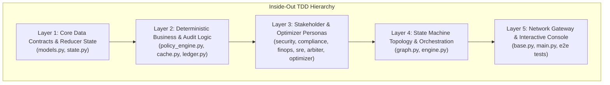

# Nemawashi Multi-Agent Governance Engine: Master TDD Engineering Prompts
## Prescriptive Module Execution Prompts (MEP) for Gemini 3.8 Flash & DeepSeek

> **Project Name**: Nemawashi Enterprise Multi-Agent Governance Engine  
> **Workspace Path**: `C:\WWORKING_folder\ProjectFolders\Nemawashi-Governance-Engine\`  
> **Target LLMs**: Gemini 3.8 Flash / DeepSeek-V3 / DeepSeek-R1  
> **Development Paradigm**: Strict Inside-Out, Test-Driven Development (TDD)  
> **Runtime**: Python 3.12 (CPython 3.12.15 via `uv`)  
> **Orchestrator**: LangGraph StateGraph with `typing.Annotated` Reducers  
> **Technical Requirements Reference**: [`TRD.md`](file:///C:/WWORKING_folder/ProjectFolders/Nemawashi-Governance-Engine/docs/TRD.md)  
> **Product Requirements Reference**: [`PRD.md`](file:///C:/WWORKING_folder/ProjectFolders/Nemawashi-Governance-Engine/docs/PRD.md)  
> **Core Architecture Reference**: [`IMPLEMENTATION_PLAN.md`](file:///C:/WWORKING_folder/ProjectFolders/Nemawashi-Governance-Engine/docs/IMPLEMENTATION_PLAN.md)  
> **User Requirements Reference**: [`URD.md`](file:///C:/WWORKING_folder/ProjectFolders/Nemawashi-Governance-Engine/docs/URD.md)  

---

## 1. Engineering Philosophy & TDD Execution Rules

When executing any step within this specification, the implementing AI platform engineer or code-generation model MUST adhere to the following non-negotiable constraints:

1. **Strict Inside-Out Dependency Sequence**:
   - Never implement a high-level component before its underlying contracts and dependencies are fully built, typed, and unit-tested.
   - Sequence: **Data Contracts** $\rightarrow$ **Deterministic Logic** $\rightarrow$ **Stakeholder Personas** $\rightarrow$ **State Machine Topology** $\rightarrow$ **Network Gateway & CLI**.
2. **Strict Test-Driven Development (Red-Green-Refactor)**:
   - For every single module, write the comprehensive test file in `tests/test_<module>.py` **FIRST** (`RED`).
   - Implement the corresponding production file in `src/nemawashi/.../<module>.py` **SECOND** (`GREEN`).
   - Verify that all unit tests pass with zero errors before moving to the next module (`REFACTOR`).
3. **No Hallucinated Schemas or Conversational Text in State**:
   - Multi-agent communication is strictly governed by immutable Pydantic v2 models (`StructuredAgentVote`). Free-form string chatter between agents is prohibited (`extra="forbid"`, `frozen=True`).
4. **Monomorphic Channel Reducers & Inflation Defense**:
   - `append_vote` strictly accepts ONLY a singular `StructuredAgentVote` instance. If a list or collection is passed, it explicitly raises a `TypeError` at the boundary, preventing vote inflation vectors.
   - Channel updates are deep-copied (`copy.deepcopy`) to block downstream in-place mutation attacks.
   - `stakeholder_map: Dict[str, str]` is populated by each stakeholder node, providing direct lookup for `consensus_router`.
5. **Deterministic Watchdog Circuit Breaker**:
   - `consensus_router` must deterministically evaluate `current_round > max_rounds` as its first priority check, routing straight to a structural `CONSENSUS_VETO` to eliminate infinite token drain.
6. **Asynchronous Non-Blocking HITL Checkpointing**:
   - Blocking terminal console interactions are completely eliminated.
   - High-impact proposals serialize state to `storage/suspended_states/{proposal_id}.json`, emit an asynchronous webhook notification, and release the thread cleanly to `END`.
   - A secure FastAPI ingress gateway (`POST /resume`) handles callbacks, applies operator decisions, and triggers resumption directly toward the audit ledger.
7. **Immutable Terminal Audit Node**:
   - `commit_chained_audit_ledger_node` is the single terminal node directly preceding `END`. State cannot be mutated once committed.



---

## 2. Layer 1: Core Data Contracts & Reducer State

### MEP-1.1: Core Data Contracts (`models.py`)
```markdown
### MODULE EXECUTION PROMPT: MEP-1.1
**Target Module**: `src/nemawashi/core/models.py`  
**Test Module**: `tests/test_models.py`  
**Prerequisites**: Clean Python 3.12 venv with `pydantic>=2.0.0`

**Objective**:
Define the fundamental Pydantic v2 data models governing proposals, structured votes, resolutions, pricing grids, and audit ledger records.

**TDD Step 1 (RED - Test Suite)**:
Create `tests/test_models.py` with test cases:
1. `test_structured_agent_vote_valid()`: Instantiates with valid stakeholder_id ("security"), vote ("APPROVE"), risk_tags, mitigation_requirements.
2. `test_structured_agent_vote_extra_forbidden()`: Asserts `ValidationError` when arbitrary string keys are supplied (`extra="forbid"`).
3. `test_structured_agent_vote_invalid_stakeholder()`: Asserts `ValidationError` for unauthorized stakeholder IDs.
4. `test_structured_agent_vote_invalid_vote()`: Asserts `ValidationError` for votes other than "APPROVE", "REJECT", "MITIGATE".
5. `test_structured_agent_vote_frozen()`: Asserts `ValidationError` when attempting post-instantiation attribute assignment (`frozen=True`).
6. `test_agent_proposal_defaults_and_validation()`: Validates `proposal_id`, cost >= 0, blast radius [0, 100], ISO 8601 UTC timestamp defaults.
7. `test_resolution_model()`: Validates verdict enums, composite risk [0, 100], boolean flags.
8. `test_usage_metadata_and_pricing()`: Validates `UsageMetadata` and `ModelPricing.calculate_cost()` across `MODEL_PRICING_GRID`.
9. `test_audit_record_validation()`: Validates block completeness and forbidden extra fields.

**TDD Step 2 (GREEN - Production Code)**:
Create `src/nemawashi/core/models.py`:
- `StructuredAgentVote(BaseModel)`: `model_config = ConfigDict(extra="forbid", frozen=True)`
  - `stakeholder_id: Literal["security", "compliance", "finops", "sre"]`
  - `vote: Literal["APPROVE", "REJECT", "MITIGATE"]`
  - `risk_tags: List[str] = Field(default_factory=list)`
  - `mitigation_requirements: List[str] = Field(default_factory=list)`
- `UsageMetadata(BaseModel)`: `prompt_tokens: int`, `completion_tokens: int`, `total_tokens: int`, `cost_usd: float`
- `ModelPricing(BaseModel)`: `input_cost_per_million: float`, `output_cost_per_million: float`, `calculate_cost()` method.
- `MODEL_PRICING_GRID`: Pre-configured dictionary mapping `"gemini-2.5-flash"` ($0.075/$0.30), `"gemini-1.5-pro"` ($1.25/$5.00), `"offline-mock"`.
- `AgentProposal(BaseModel)`: `proposal_id: str`, `proposing_agent: str`, `action_type: str`, `action_description: str`, `target_resource: str`, `estimated_cost_usd: float`, `estimated_blast_radius: int`, `parameters: Dict[str, Any]`, `timestamp: str`.
- `Resolution(BaseModel)`: `proposal_id: str`, `verdict: Literal[...]`, `composite_risk_score: int`, `mandatory_mitigations: List[str]`, `requires_human_approval: bool`, `requires_revision: bool`, `summary: str`.
- `AuditRecord(BaseModel)`: `index: int`, `timestamp: str`, `proposal_id: str`, `action_type: str`, `verdict: str`, `execution_permitted: bool`, `composite_risk_score: int`, `stakeholder_votes: Dict`, `mitigations: List[str]`, `human_approval: Optional[Dict]`, `deliberation_round: int`, `prompt_tokens: int`, `completion_tokens: int`, `total_cost_usd: float`, `previous_hash: str`, `record_hash: str`.

**Verification**:
Run: `pytest tests/test_models.py -v` (Must pass 100%).
```

---

### MEP-1.2: State Contract & Channel Reducers (`state.py`)
```markdown
### MODULE EXECUTION PROMPT: MEP-1.2
**Target Module**: `src/nemawashi/core/state.py`  
**Test Module**: `tests/test_state_reducers.py`  
**Prerequisites**: MEP-1.1 completed and passing

**Objective**:
Implement the LangGraph TypedDict state contract with custom reducers to eliminate consensus amnesia, block vote inflation attacks, and support atomic token accounting.

**TDD Step 1 (RED - Test Suite)**:
Create `tests/test_state_reducers.py`:
1. `test_append_vote_accumulation()`: Verifies `append_vote(None, v1)` returns `[v1]`; `append_vote([v1], v2)` returns `[v1, v2]`; `append_vote([v1, v2], v3)` returns `[v1, v2, v3]`.
2. `test_append_vote_rejects_list_polymorphism()`: Asserts `TypeError` when a list or tuple of votes is passed to `append_vote`, enforcing single-item monomorphism.
3. `test_append_vote_blocks_inplace_mutations()`: Asserts `copy.deepcopy` isolation so mutating returned lists does not corrupt existing state.
4. `test_append_ledger_record_accumulation()`: Verifies `append_ledger_record` accumulates dictionaries immutably.
5. `test_accumulate_tokens_reducer()`: Verifies atomic summation for input tokens handling `None` and integers.
6. `test_accumulate_costs_reducer()`: Verifies atomic summation for floating point costs with 6-decimal-place rounding.
7. `test_create_initial_state()`: Validates initial state dictionary construction (`current_round=1`, `max_rounds=3`, `loop_veto_triggered=False`, token counts=0, `stakeholder_map={}`, `suspended_for_hitl=False`).

**TDD Step 2 (GREEN - Production Code)**:
Create `src/nemawashi/core/state.py`:
- Define reducer functions:
  - `append_vote(existing: Optional[List[StructuredAgentVote]], new_vote: StructuredAgentVote) -> List[StructuredAgentVote]`
  - `append_ledger_record(existing, new_records) -> List[Dict[str, Any]]`
  - `accumulate_tokens(existing, new_tokens) -> int`
  - `accumulate_costs(existing, new_cost) -> float`
- Define `NemawashiState(TypedDict, total=False)`:
  - `proposal: AgentProposal`
  - `policy_passed: bool`
  - `policy_violations: List[str]`
  - `cache_hit: bool`
  - `cached_resolution: Optional[Resolution]`
  - `votes: Annotated[List[StructuredAgentVote], append_vote]`
  - `stakeholder_votes: Dict[str, StructuredAgentVote]`
  - `stakeholder_map: Dict[str, str]`
  - `audit_ledger: Annotated[List[Dict[str, Any]], append_ledger_record]`
  - `prompt_tokens: Annotated[int, accumulate_tokens]`
  - `completion_tokens: Annotated[int, accumulate_tokens]`
  - `total_cost_usd: Annotated[float, accumulate_costs]`
  - `cost_optimization_applied: bool`
  - `optimized_proposal_parameters: Dict[str, Any]`
  - `current_round: int`
  - `max_rounds: int`
  - `loop_veto_triggered: bool`
  - `resolution: Optional[Resolution]`
  - `human_approved: Optional[bool]`
  - `execution_permitted: bool`
  - `human_rationale: str`
  - `audit_committed: bool`
  - `audit_record_hash: Optional[str]`
  - `suspended_for_hitl: bool`
- Define `create_initial_state(proposal, max_rounds=3, human_approved=None) -> NemawashiState`.

**Verification**:
Run: `pytest tests/test_state_reducers.py -v` (Must pass 100%).
```

---

## 3. Layer 2: Deterministic Business & Audit Logic

### MEP-2.1: Policy Pre-Check Engine (`policy_engine.py`)
```markdown
### MODULE EXECUTION PROMPT: MEP-2.1
**Target Module**: `src/nemawashi/policies/policy_engine.py`  
**Configuration**: `src/nemawashi/policies/enterprise_rules.json`  
**Test Module**: `tests/test_policy_engine.py`  
**Prerequisites**: MEP-1.1 completed

**Objective**:
Implement the deterministic hard-policy pre-check engine that instantly vetos non-negotiable enterprise violations in <5ms prior to any LLM invocation.

**TDD Step 1 (RED - Test Suite)**:
Create `tests/test_policy_engine.py`:
1. `test_clean_proposal_passes_precheck()`: Verifies low-impact compliant proposal yields `passed=True`, 0 violations, `requires_hitl=False`.
2. `test_prohibited_action_triggers_hard_veto()`: Verifies `drop_production_database` triggers `passed=False` and `PROHIBITED_ACTION` violation.
3. `test_protected_target_substring_triggers_veto()`: Verifies target containing `prod-primary-db` triggers `passed=False` and `PROTECTED_RESOURCE` violation.
4. `test_excessive_cost_triggers_hard_veto()`: Verifies cost > $5,000.00 triggers `BUDGET_CEILING_BREACH`.
5. `test_hitl_escalation_triggers()`: Verifies cost >= $500 or blast radius >= 80 yields `requires_hitl=True`.

**TDD Step 2 (GREEN - Production Code)**:
1. Create `src/nemawashi/policies/enterprise_rules.json` with spend caps, prohibited actions, protected target substrings, and sensitive resources.
2. Create `src/nemawashi/policies/policy_engine.py`:
   - `PolicyEvaluationResult(BaseModel)`: `passed: bool`, `violations: List[str]`, `requires_hitl: bool`, `hitl_reasons: List[str]`.
   - `evaluate_proposal_policies(proposal: AgentProposal, rules_path=None) -> PolicyEvaluationResult`.

**Verification**:
Run: `pytest tests/test_policy_engine.py -v` (Must pass 100%).
```

---

### MEP-2.2: Semantic Proposal Vector Cache (`cache.py`)
```markdown
### MODULE EXECUTION PROMPT: MEP-2.2
**Target Module**: `src/nemawashi/core/cache.py`  
**Test Module**: `tests/test_cache.py`  
**Prerequisites**: MEP-1.1 completed

**Objective**:
Implement the local vector semantic caching engine to match incoming proposals against previously deliberated resolutions using cosine similarity, bypassing the multi-agent circle on matches >= 0.95 with 24-hour TTL and enterprise rules hash invalidation hygiene.

**TDD Step 1 (RED - Test Suite)**:
Create `tests/test_cache.py`:
1. `test_text_embedding_properties()`: Verifies deterministic unit vector generation, L2 normalization, identical text similarity = 1.0, dissimilar text < 0.6.
2. `test_semantic_cache_store_and_lookup()`: Tests empty cache miss -> store resolution -> lookup identical proposal hit (>= 0.95) -> lookup similar phrasing hit (>= 0.90) -> lookup dissimilar proposal miss -> persistence across re-instantiation -> cache clear.

**TDD Step 2 (GREEN - Production Code)**:
Create `src/nemawashi/core/cache.py`:
- `compute_text_embedding(text: str, dim: int = 64) -> List[float]`
- `cosine_similarity(v1: List[float], v2: List[float]) -> float`
- `SemanticProposalCache`: `lookup(proposal: AgentProposal) -> Optional[CacheMatch]`, `store(proposal, resolution)`, `clear()`.

**Verification**:
Run: `pytest tests/test_cache.py -v` (Must pass 100%).
```

---

### MEP-2.3: Cryptographically Chained SHA-256 Terminal Ledger (`ledger.py`)
```markdown
### MODULE EXECUTION PROMPT: MEP-2.3
**Target Module**: `src/nemawashi/audit/ledger.py`  
**Test Module**: `tests/test_audit_chain.py`  
**Prerequisites**: MEP-1.1 completed

**Objective**:
Implement the immutable audit ledger using forward SHA-256 hash chaining, configured as the strict terminal LangGraph node directly preceding `END`.

**Ledger Calculation Invariant**:
$$\text{record\_hash} = \text{SHA256}(\text{index} + \text{previous\_hash} + \text{timestamp} + \text{proposal\_id} + \text{verdict} + \text{execution\_permitted} + \text{composite\_risk} + \text{votes} + \text{mitigations} + \text{human\_approval} + \text{round})$$

**TDD Step 1 (RED - Test Suite)**:
Create `tests/test_audit_chain.py`:
1. `test_genesis_record_hash_chaining()`: Asserts first block chains to 64 zeros (`"0" * 64`) and sets `audit_committed=True`.
2. `test_sequential_hash_linkage()`: Verifies Block 1 `previous_hash` equals Block 0 `record_hash`.
3. `test_tamper_detection_in_ledger_chain()`: Modifying a byte in a committed record causes `verify_ledger_chain()` to return `False` identifying the tampered index.
4. `test_state_immutability_assertion()`: Calling `commit_chained_audit_ledger_node` on an already-committed state raises `RuntimeError`.

**TDD Step 2 (GREEN - Production Code)**:
Create `src/nemawashi/audit/ledger.py`:
- `calculate_record_hash(...) -> str`
- `commit_chained_audit_ledger_node(state: NemawashiState, ledger_path=None) -> Dict[str, Any]`
- `verify_ledger_chain(ledger_path=None) -> Tuple[bool, str]`

**Verification**:
Run: `pytest tests/test_audit_chain.py -v` (Must pass 100%).
```

---

## 4. Layer 3: Stakeholder & Optimizer Personas

### MEP-3.1: Specialized Stakeholder Agents & Arbiter
```markdown
### MODULE EXECUTION PROMPT: MEP-3.1
**Target Modules**:
- `src/nemawashi/agents/security.py`
- `src/nemawashi/agents/compliance.py`
- `src/nemawashi/agents/finops.py`
- `src/nemawashi/agents/reliability.py`
- `src/nemawashi/agents/arbiter.py`
**Test Module**: `tests/test_agents.py`  
**Prerequisites**: Layers 1 and 2 completed

**Objective**:
Implement the four specialized stakeholder personas and the Consensus Arbiter with domain evaluation heuristics, risk tagging, and composite risk scoring.

**TDD Step 1 (RED - Test Suite)**:
Create `tests/test_agents.py`:
1. `test_security_guardian_evaluation()`: Verifies `0.0.0.0/0` ingress and IAM privilege escalation trigger `MITIGATE` with specific risk tags.
2. `test_compliance_arbiter_evaluation()`: Verifies GDPR PII, HIPAA PHI, and prior security exposure trigger regulatory mitigations.
3. `test_finops_arbiter_evaluation()`: Verifies costs > $1000 trigger `MITIGATE` with budget consumption tags.
4. `test_sre_sentinel_evaluation()`: Verifies blast radius > 50 and DDL migrations trigger automated rollback requirements.
5. `test_consensus_arbiter_synthesis()`: Validates unanimous consensus, composite risk formula, and human escalation triggers.

**TDD Step 2 (GREEN - Production Code)**:
1. Create system prompt markdown files in `prompts/`.
2. Implement stakeholder classes in `src/nemawashi/agents/`:
   - `SecurityGuardianAgent`
   - `ComplianceArbiterAgent`
   - `FinOpsArbiterAgent`
   - `SRESentinelAgent`
   - `ConsensusArbiterAgent`

**Verification**:
Run: `pytest tests/test_agents.py -v` (Must pass 100%).
```

---

### MEP-3.2: Adaptive Cost Optimization Persona (`optimizer.py`)
```markdown
### MODULE EXECUTION PROMPT: MEP-3.2
**Target Module**: `src/nemawashi/agents/optimizer.py`  
**Test Module**: `tests/test_optimizer.py`  
**Prerequisites**: MEP-3.1 completed

**Objective**:
Implement the `CostOptimizationAgent` persona that restructures cloud infrastructure proposals flagged for cost mitigations, applying spot instances and savings plans to achieve 30%–55% cost reductions.

**TDD Step 1 (RED - Test Suite)**:
Create `tests/test_optimizer.py`:
1. `test_optimizer_high_cost_reduction()`: Submits proposal with cost $2,000.00 -> verifies cost reduced by >= 40%, spot instance parameters injected, compute savings plan attached.
2. `test_optimizer_moderate_cost_reduction()`: Submits proposal with cost $350.00 -> verifies idle shutdown parameters and gp3 storage optimization injected.
3. `test_optimizer_preserves_original_proposal()`: Verifies deepcopy prevents in-place mutation of the input proposal object.

**TDD Step 2 (GREEN - Production Code)**:
1. Create `prompts/cost_optimizer.md`.
2. Implement `CostOptimizationAgent.optimize(proposal: AgentProposal, finops_vote: Optional[StructuredAgentVote]) -> AgentProposal` in `src/nemawashi/agents/optimizer.py`.

**Verification**:
Run: `pytest tests/test_optimizer.py -v` (Must pass 100%).
```

---

## 5. Layer 4: State Machine Topology & Orchestration

### MEP-4.1: LangGraph StateGraph & High-Level Engine
```markdown
### MODULE EXECUTION PROMPT: MEP-4.1
**Target Modules**:
- `src/nemawashi/core/graph.py`
- `src/nemawashi/core/engine.py`
**Test Module**: `tests/test_langgraph_routing.py`  
**Prerequisites**: Layers 1, 2, and 3 completed

**Objective**:
Assemble the complete LangGraph StateGraph connecting intake, policy pre-checks, semantic caching, sequential consensus nodes, adaptive cost optimizer branching, watchdog routing, non-blocking HITL checkpointing, and the strict terminal audit ledger node.

**TDD Step 1 (RED - Test Suite)**:
Update `tests/test_langgraph_routing.py`:
1. `test_mitigation_loop_watchdog_exceeded()`: `current_round > max_rounds` -> immediate veto.
2. `test_mitigation_loop_watchdog_boundary_revision()`: Boundary revision check halts at ceiling.
3. `test_sequential_consensus_circle_populates_all_stakeholders()`: Clean proposal -> Sec -> Comp -> Fin -> SRE -> Arbiter -> ledger.
4. `test_immediate_veto_terminal_routing()`: Prohibited action -> immediate veto -> ledger -> `END`.
5. `test_hitl_approval_and_rejection_routing()`: Validates pre-approved vs. rejected paths.
6. `test_hitl_non_blocking_suspension_and_resumption()`: Evaluates proposal without human decision -> serializes state to storage -> exits thread cleanly to END -> resumes via `engine.resume_proposal` -> commits to ledger.
7. `test_fastapi_gateway_resume_endpoint()`: Tests FastAPI `/resume` route with valid and invalid requests.
8. `test_stakeholder_map_population()`: Verifies `stakeholder_map` is populated by all 4 stakeholders.

**TDD Step 2 (GREEN - Production Code)**:
1. Implement `build_nemawashi_graph() -> StateGraph` in `src/nemawashi/core/graph.py`:
   - Register nodes and transitions: intake, policy pre-check, semantic cache, 4 stakeholder nodes emitting single votes, arbiter, cost optimizer, revision, immediate veto, non-blocking gatekeeper, and terminal ledger node. Resumed states enter the ledger directly from the `/resume` route.
   - Implement `save_suspended_state()`, `load_suspended_state()`, and `emit_mock_notification_webhook()`.
2. Implement `NemawashiEngine` in `src/nemawashi/core/engine.py`:
   - `evaluate_proposal(proposal, human_approved=None) -> NemawashiState`
   - `resume_proposal(proposal_id, approved, rationale) -> NemawashiState`
   - `verify_audit_ledger() -> Tuple[bool, str]`

**Verification**:
Run: `pytest tests/test_langgraph_routing.py -v` (Must pass 100%).
```

---

## 6. Layer 5: Network Gateway & Interactive Console

### MEP-5.1: Gemini Network Gateway, FastAPI Ingress & Interactive Console
```markdown
### MODULE EXECUTION PROMPT: MEP-5.1
**Target Modules**:
- `src/nemawashi/agents/base.py`
- `src/nemawashi/main.py`
**Test Modules**:
- `tests/test_gemini_schema.py`
- `tests/test_e2e_scenarios.py`
- `tests/test_gateway_auth.py`
**Prerequisites**: Layers 1 through 4 completed

**Objective**:
Implement the live Gemini API gateway using the official Google GenAI SDK (`google-genai`) with native `response_schema` binding, construct the FastAPI `/resume` callback ingress gateway with mandatory HMAC-SHA256 authentication, and build the interactive Rich CLI console.

**TDD Step 1 (RED - Test Suite)**:
1. `tests/test_gemini_schema.py`:
   - Validates that `StructuredAgentVote.model_json_schema()` complies with Gemini native structured output constraints.
   - Validates that all stakeholder agents produce schema-compliant votes in offline mode.
2. `tests/test_e2e_scenarios.py`:
   - Executes end-to-end multi-agent governance across 4 production scenarios:
     * Scenario 1: Cache cluster deployment -> `UNANIMOUS_CONSENSUS`.
     * Scenario 2: Staging database migration -> `CONDITIONAL_ALIGNMENT`.
     * Scenario 3: Destructive database drop -> `CONSENSUS_VETO`.
     * Scenario 4: High-value GPU cluster expansion -> Non-blocking suspension and resumption.
   - Executes `verify_ledger_chain()` to prove 100% cryptographic integrity.
3. `tests/test_gateway_auth.py`:
   - Validates mandatory HMAC-SHA256 signature verification on `POST /resume` (`hmac.compare_digest`).
   - Asserts HTTP 401 on missing, truncated, or tampered signature headers/tokens.
   - Asserts HTTP 400/422 on path-traversal `proposal_id` payloads and `_state_hmac` disk tampering.

**TDD Step 2 (GREEN - Production Code)**:
1. Complete `src/nemawashi/agents/base.py`:
   - Enforces `<untrusted_proposal_data>` prompt framing and `is_relative_to` path containment.
   - Validates candidate votes via `StructuredAgentVote.model_validate()`.
   - Calculates synthetic token counts derived from proposal string length.
2. Complete `src/nemawashi/main.py`:
   - Configures FastAPI app gateway with `/resume` POST route and HMAC-SHA256 authentication.
   - Implements Rich console demonstration for interactive CLI execution.

**Verification**:
Run gateway & scenario tests: `pytest tests/test_gemini_schema.py tests/test_e2e_scenarios.py tests/test_gateway_auth.py -v` (Must pass 100%).
Run full test suite: `pytest tests -v` (All 66 tests must pass).
Run interactive CLI: `python -m nemawashi.main`.
```

---

## 7. Master Test & Verification Matrix

| Layer | Component | Test File | Test Count | Target Invariant Verified |
|---|---|---|---|---|
| **L1** | `models.py` | `tests/test_models.py` | 9 | Schema validation, `extra="forbid"`, `frozen=True`, pricing grid |
| **L1** | `state.py` | `tests/test_state_reducers.py` | 7 | Monomorphic `append_vote`, list inflation rejection, deep-copying |
| **L2** | `policy_engine.py` | `tests/test_policy_engine.py` | 5 | Blacklists, spend caps, <5ms deterministic policy checks |
| **L2** | `cache.py` | `tests/test_cache.py` | 5 | L2 vector embeddings, cosine similarity matching >= 0.95, 24h TTL, vote lineage |
| **L2** | `ledger.py` | `tests/test_audit_chain.py` | 6 | SHA-256 block hash chaining, filelock mutex locking, Timeout handling |
| **L3** | `agents/*.py` | `tests/test_agents.py` | 5 | Zero-trust, GDPR/HIPAA, FinOps spend caps, blast radius dampening |
| **L3** | `optimizer.py` | `tests/test_optimizer.py` | 3 | Dynamic infrastructure rightsizing, spot conversion, cost reduction |
| **L4** | `graph.py` | `tests/test_langgraph_routing.py` | 10 | Watchdog breaker, dynamic optimizer, slate reset, post-revision re-check |
| **L5** | `base.py` | `tests/test_gemini_schema.py` | 2 | Gemini native `response_schema` compatibility, `model_validate` boundary |
| **L5** | `gateway` | `tests/test_gateway_auth.py` | 9 | HMAC-SHA256 signature verification, _state_hmac disk security, path traversal |
| **L5** | `main.py` | `tests/test_e2e_scenarios.py` | 5 | Production scenarios, FastAPI resumption, complete ledger chain proof |
| **Total** | **All Layers** | **11 Test Modules** | **66** | **100% Passing Green across the entire architecture** |
